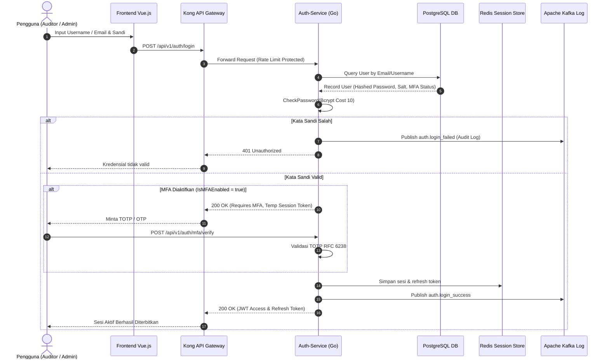

# A.5.17 Informasi Autentikasi

> *Ringkasan internal untuk checklist kesiapan bukti. Bukan pengganti Statement of Applicability (SoA) resmi.*

---

| Parameter | Nilai |
| :--- | :--- |
| **Tema** | Organizational |
| **Judul kontrol** | Informasi autentikasi |
| **Fokus pemeriksaan** | Kredensial diterbitkan, disimpan, dan digunakan secara aman |
| **Contoh bukti objektif** | Password/MFA policy, konfigurasi, proses reset, sampel log |
| **Sistem** | AuditSphere (auditsphere.app), VPS 202.10.34.160 / 202.10.34.166 dan Cloud SaaS |
| **PIC** | Lead Information Security / DevSecOps (Reza) |
| **Reviewer** | [isi saat validasi] (Dimas / Group Vision) |
| **Tanggal validasi** | [isi saat validasi] |

---

## Ringkasan Nilai untuk Checklist

| Kolom checklist | Nilai | Catatan singkat |
| :--- | :--- | :--- |
| **Relevansi SoA** | **Berlaku** | Seluruh akses pengguna (Auditor, CAE, Admin, Auditee) ke sistem AuditSphere wajib diamankan melalui proses penerbitan, penyimpanan, pengelolaan, dan verifikasi informasi autentikasi yang tangguh. |
| **Status implementasi** | **Dalam proses** | Hashing kata sandi berbasis Bcrypt (cost 10), mesin TOTP/Email OTP, token blacklist Redis, dan force change password sudah aktif di repositori; namun pembatasan lockout, masa berlaku kata sandi, dan riwayat sandi belum diaktifkan. |
| **Ketersediaan bukti** | **Ada sebagian** | Kode backend auth-service, utilitas hashing bcrypt, DTO validasi, log autentikasi Kafka, dan dokumen keselarasan ISO-AS-001 tersedia; SOP Kebijakan Autentikasi & Kata Sandi formal (PWP-001) belum disahkan. |
| **Evidence ID / URL** | **Belum terdaftar** | Usulan EV-A5.17-01 s/d EV-A5.17-06 (lihat bagian 6). ID perlu didaftarkan di Master Audit Evidence Index. |
| **Efektivitas operasional** | **Sebagian efektif** | Utilitas kriptografi Bcrypt, penerbitan JWT terproteksi, pencabutan token logout via Redis, dan verifikasi MFA TOTP berjalan efektif; namun akun belum terkunci otomatis saat terjadi serangan brute-force berulang (5 kali gagal). |
| **Desain kontrol** | **Perlu perbaikan** | Validasi backend models/dto.go masih mengizinkan panjang sandi minimum 6 karakter (frontend 8 karakter), sedangkan standar ISO-AS-001 Bab 8.2 mewajibkan minimal 12 karakter alfanumerik dan simbolik. |
| **Status kesiapan** | **Belum siap** | Terdapat kesenjangan teknis pada penegakan penguncian akun (account lockout), rotasi sandi 90 hari, riwayat 5 sandi terakhir, dan kewajiban MFA bagi peran kritikal sebelum audit sertifikasi. |
| **Prioritas** | **Tinggi** | Autentikasi merupakan garda terdepan sistem (perimeter pertahanan utama); kegagalan kontrol dapat memicu pengambilalihan akun (account takeover), kebocoran KKA/LHA, dan ketidaksesuaian mayor ISO 27001. |
| **Review berikutnya** | **[isi]** | Usulan: 6 bulan setelah pengesahan SOP Kebijakan Autentikasi dan pengaktifan mekanisme lockout otomatis di production. |

---

## 1. Justifikasi Relevansi (Berlaku)

Kontrol A.5.17 **berlaku** untuk AuditSphere karena:

1. **Perlindungan Akses ke Kertas Kerja Audit Sensitif**: AuditSphere mengelola temuan audit internal, KKA, register risiko enterprise, dan data kecurangan korporasi (*fraud*). Seluruh hak akses harus dilindungi oleh kredensial autentikasi unik untuk mencegah akses tidak sah.
2. **Kepatuhan Terhadap Standar ISO/IEC 27001:2022 Kontrol A.5.17**: Standar mewajibkan bahwa alokasi dan pengelolaan informasi autentikasi dikendalikan melalui proses manajemen yang mencakup saran kepada pengguna mengenai penanganan informasi autentikasi yang tepat.
3. **Pemberlakuan Multi-Factor Authentication (MFA)**: Sesuai dokumen keselarasan ISO-AS-001 Bab 8.2, akun pengguna dengan hak istimewa (*privileged roles*) seperti Administrator, Chief Audit Executive (CAE), dan Audit Manager wajib menerapkan autentikasi multi-faktor berbasis waktu (TOTP) atau One-Time Password (OTP).
4. **Pencegahan Serangan Brute-Force dan Credential Stuffing**: Tanpa penguncian akun otomatis (*account lockout*) dan validasi kompleksitas kata sandi yang ketat, endpoint publik login rentan terhadap serangan kamus (*dictionary attack*) dan tebak kata sandi massal.
5. **Penegakan Akuntabilitas Individu (Non-Repudiation)**: Informasi autentikasi yang unik dan tidak dibagikan menjamin bahwa seluruh tindakan yang tercatat dalam log audit trail sistem dapat diatribusikan secara definitif kepada individu tertentu.

---

## 2. Implementasi yang Sudah Ada

Berdasarkan penelusuran kode sumber pada repositori `risk-based-audit`, komponen kontrol autentikasi yang telah diimplementasikan meliputi:

### 2.1 Arsitektur Autentikasi Terpusat & Kriptografi Kata Sandi
- **Hashing Kriptografis yang Kuat**: File `backend/auth-service/pkg/utils/password.go` mengimplementasikan fungsi `HashPassword(password string)` menggunakan algoritma **Bcrypt** (`golang.org/x/crypto/bcrypt`) dengan parameter `bcrypt.DefaultCost` (cost factor 10). Fungsi ini otomatis membangkitkan *salt* acak kriptografis untuk mencegah serangan *rainbow tables*.
- **Pencocokan Sandi Aman**: Fungsi `CheckPassword(hashedPassword, password string)` melakukan verifikasi secara konstan terhadap *timing attack*.
- **Manajemen Sesi JWT Terproteksi**: Penerbitan Access Token dan Refresh Token menggunakan pustaka `golang-jwt/jwt/v5` dengan algoritma HMAC-SHA256. Access Token memiliki masa berlaku singkat (15 menit) dan Refresh Token disimpan pada tabel `refresh_tokens` dengan masa kedaluwarsa 7 hari.
- **Pencabutan Sesi (Token Blacklist)**: Pada saat pengguna keluar (*logout* via `POST /auth/logout`), token akses dicatat ke dalam cache **Redis** dengan kunci `token:<jwt>` dan status `revoked` selama sisa masa aktif token (`auth_service.go:348`).

### 2.2 Multi-Factor Authentication (MFA)
- **Engine TOTP & Email OTP**: Modul `backend/auth-service/services/mfa/mfa_service.go` mendukung dua metode MFA:
  1. *Time-based One-Time Password (TOTP)* berbasis RFC 6238 kompatibel dengan Google Authenticator dan Microsoft Authenticator, lengkap dengan pembangkitan URI QR Code (`otpauth://totp/...`).
  2. *Email OTP* yang mengirimkan 6 digit kode acak dengan masa berlaku 5 menit menggunakan layanan email transaksional Resend (`resend.com/v1`).
- **Penyimpanan Kunci Rahasia Terenkripsi**: Entitas `MFASetup` (`models/user.go`) menyimpan *secret key* TOTP dan kode cadangan pemulihan (*backup codes*) terenkripsi.

### 2.3 Manajemen Perangkat Tepercaya (Trusted Devices)
- Pada `backend/auth-service/models/user.go`, entitas `TrustedDevice` mencatat sidik jari perangkat klien (*client device fingerprint*) yang di-hash menggunakan SHA-256 (`FingerprintHash`), User-Agent, IP publik, dan timestamp `ExpiresAt` (maksimum 30 hari).
- Endpoint `POST /auth/devices/trust` memungkinkan pengguna memverifikasi perangkat tepercaya guna mengurangi friksi login tanpa mengorbankan keamanan perimeter.

### 2.4 Kredensial Sementara & Paksa Ganti Kata Sandi (Force Password Reset)
- **Pembangkitan Sandi Sementara**: Fungsi `GenerateTemporaryPassword()` pada `pkg/utils/password.go` menghasilkan kata sandi acak sepanjang 12 karakter alfanumerik yang secara eksplisit menghilangkan karakter ambigu (*lookalike characters*) seperti `0`, `O`, `l`, `1`, `I` guna mencegah kesalahan pembacaan oleh pengguna baru.
- **Penegakan Perubahan Sandi Pertama Kali**: Kolom `MustChangePassword` (`models/user.go`) menandai pengguna yang baru dibuat oleh Administrator. Jika bernilai `true`, pengguna diarahkan langsung ke halaman `frontend/pages/auth/change-password.vue` dan token sesi dibatasi hingga kata sandi baru ditetapkan.

### 2.5 Pencatatan Log Audit Trail Keamanan Autentikasi
- File `backend/auth-service/services/auth/auth_service.go` mempublikasikan seluruh kejadian autentikasi ke broker pesan **Apache Kafka** dengan topik `audit-logs` dan event types:
  - `auth.login_success`
  - `auth.login_failed`
  - `auth.logout`
  - `auth.password_changed`
  - `auth.mfa_enabled` / `auth.mfa_disabled`
- Selain itu, log keamanan dicatat pada tabel PostgreSQL `sys_alert_logs` dengan tingkat keparahan (*severity*) terstruktur.

---

## 3. Identifikasi Kesenjangan (Gap Analysis)

Berdasarkan perbandingan antara kode sumber repositori, dokumen keselarasan ISO-AS-001 Bab 8.2, dan klausul ISO/IEC 27001:2022 Kontrol A.5.17, ditemukan beberapa kesenjangan teknis dan tata kelola:

| No | Parameter Pemeriksaan | Target Standar ISO-AS-001 (Bab 8.2) | Kondisi Aktual pada Repositori | Status Kesenjangan |
| :-: | :--- | :--- | :--- | :-: |
| 1 | **Panjang Sandi Minimum** | Minimal 12 karakter | Backend DTO (`models/dto.go`) memvalidasi `min=6`; Frontend `change-password.vue` memvalidasi `min=8` | **Gap Validasi** (Perlu diselaraskan ke 12) |
| 2 | **Kompleksitas Sandi** | Kombinasi huruf besar, kecil, angka, dan karakter spesial | Frontend memvalidasi kombinasi karakter; Backend belum memiliki regex validasi karakter khusus | **Gap Validasi Backend** |
| 3 | **Penguncian Akun (Lockout)** | Kunci akun selama 30 menit setelah 5x gagal login berturut-turut | Kolom `LockedUntil` ada di `models/user.go`, namun `auth_service.go` belum menghitung counter gagal dan belum memblokir login | **Gap Teknis Kunci** (Fitur lockout belum aktif) |
| 4 | **Riwayat Sandi (History)** | Dilarang menggunakan 5 kata sandi terakhir | `ChangePassword()` hanya mengecek `newPassword != oldPassword`; belum ada tabel `password_histories` | **Gap Teknis** (Tidak ada histori sandi) |
| 5 | **Masa Berlaku Sandi** | Rotasi wajib setiap 90 hari | Belum ada kolom `password_changed_at` dan pengecekan kedaluwarsa pada `completeLogin()` | **Gap Teknis** (Sandi berlaku selamanya) |
| 6 | **Penegakan Kewajiban MFA** | Wajib untuk peran Admin, CAE, dan Audit Manager | MFA bersifat opsional (*opt-in*); belum ada penolakan login jika peran penting belum mengaktifkan MFA | **Gap Konfigurasi** |
| 7 | **Kredensial Default Seeder** | Kredensial default dilarang di lingkungan produksi | `cmd/auth/seed.go` menyetel kata sandi default `password123` untuk akun awal sistem | **Gap Keamanan** (Wajib force change di seeder) |
| 8 | **Kebijakan & SOP Formal** | Dokumen Kebijakan Autentikasi & Kata Sandi (PWP-001) bertanda tangan | Belum ada dokumen SOP formal tersendiri selain ringkasan di Bab 8.2 ISO-AS-001 | **Gap Dokumentasi** |

---

## 4. Bukti Objektif yang Sudah Tersedia

1. **Kode Sumber Utilitas Kriptografi Bcrypt**: File `backend/auth-service/pkg/utils/password.go` (`HashPassword`, `CheckPassword`, `GenerateTemporaryPassword`).
2. **Model Data Entitas Pengguna & Kredensial**: File `backend/auth-service/models/user.go` (`User`, `MFASetup`, `RefreshToken`, `TrustedDevice`, `LockedUntil`, `MustChangePassword`).
3. **Layanan Multi-Factor Authentication (MFA)**: File `backend/auth-service/services/mfa/mfa_service.go` (implementasi TOTP RFC 6238 dan email OTP via Resend API).
4. **Logika Layanan Autentikasi & Token Blacklist**: File `backend/auth-service/services/auth/auth_service.go` (penanganan login, verifikasi MFA, rotasi refresh token, pencabutan token via Redis).
5. **Rute API Autentikasi**: File `backend/auth-service/routes/registry.go` (endpoint login, register, logout, refresh, mfa, devices, change-password).
6. **Antarmuka Ubah Kata Sandi**: File `frontend/pages/auth/change-password.vue` (validasi schema zod pada klien).
7. **Standar Keamanan Kata Sandi & Sesi**: Dokumen `docs/DOKUMEN_KESELARASAN_ISO27001.md` Bab 8.2 (Kebijakan Kata Sandi & Pengelolaan Sesi).

---

## 5. Bukti Objektif yang Masih Kurang

1. **SOP Kebijakan Autentikasi dan Manajemen Kredensial (PWP-001)**: Dokumen formal yang disahkan oleh Group Vision / Direksi yang mengatur siklus hidup kredensial, larangan berbagi akun, panjang minimum, dan prosedur pemulihan.
2. **Implementasi Logic Account Lockout**: Kode backend untuk melacak percobaan gagal (`failed_login_attempts`), penguncian selama 30 menit setelah 5 kali gagal, dan pencatatan audit log `auth.account_locked`.
3. **Mekanisme Password History & Expiry 90 Hari**: Tabel basis data `user_password_histories` dan pengecekan otomatis masa kedaluwarsa sandi pada proses login.
4. **Penegakan MFA Tingkat Sistem untuk Peran Administratif**: Guard middleware yang memaksa (*enforce*) aktivasi MFA bagi pengguna dengan peran `ADMIN`, `CAE`, dan `AUDIT_MANAGER` sebelum dapat mengakses menu utama.
5. **Bukti Log Pengujian Lockout dan Rotasi Kredensial**: Sampel log operasional yang memperlihatkan respons sistem ketika terjadi percobaan akses tidak sah secara berturut-turut.

---

## 6. Usulan Bukti Objektif (Evidence ID)

Untuk memenuhi kesiapan audit sertifikasi ISO/IEC 27001:2022 pada kontrol A.5.17, diusulkan 6 Evidence ID yang wajib didaftarkan pada Master Audit Evidence Index:

| Evidence ID | Nama Bukti Objektif | Format / Media | Lokasi / Sumber | PIC Penyedia |
| :--- | :--- | :--- | :--- | :--- |
| **EV-A5.17-01** | SOP Kebijakan Autentikasi, Kata Sandi, dan MFA (SOP-SEC-004) | Dokumen PDF / Word | `docs/policies/SOP-SEC-004-Authentication-Policy.pdf` | Lead InfoSec / DevSecOps |
| **EV-A5.17-02** | Konfigurasi Kriptografi Bcrypt & Engine Autentikasi | Kode Sumber & Unit Test | `backend/auth-service/pkg/utils/password.go` & `password_test.go` | Lead Backend Engineer |
| **EV-A5.17-03** | Konfigurasi & Arsitektur Multi-Factor Authentication (TOTP & OTP) | Kode Sumber & Screenshot Setup | `backend/auth-service/services/mfa/mfa_service.go` | Lead Backend Engineer |
| **EV-A5.17-04** | Logika & Pengujian Penguncian Akun Otomatis (*Account Lockout*) | Kode Sumber & Laporan Uji QA | `backend/auth-service/services/auth/auth_service.go` | QA / DevSecOps |
| **EV-A5.17-05** | Sampel Log Keamanan Autentikasi (Audit Trail Kafka & DB) | Berkas JSON / CSV Terenkripsi | Log Kafka topik `audit-logs` / Tabel `sys_alert_logs` | DevSecOps Engineer |
| **EV-A5.17-06** | Formulir / Tiket Permintaan Reset Kredensial & Berita Acara | Tiket Jira / Helpdesk IT | Portal IT Service Management / Jira ITSM | IT Support / SecOps |

---

## 7. Rencana Aksi Perbaikan (Action Plan)

| No | Tindakan Remediasi / Peningkatan | Target Luaran Teknis | PIC | Target Waktu |
| :-: | :--- | :--- | :--- | :-: |
| 1 | **Penyusunan & Pengesahan SOP Kebijakan Autentikasi** | Dokumen SOP-SEC-004 formal bertanda tangan mencakup aturan panjang sandi, rotasi, MFA, dan sanksi | Reza / Dimas | 2 minggu |
| 2 | **Penyelarasan Validasi Panjang & Karakter Sandi** | Update `models/dto.go` dan `change-password.vue` menjadi min 12 karakter + regex huruf besar, kecil, angka, simbol | Backend Dev | 1 minggu |
| 3 | **Aktivasi Logika Account Lockout di AuthService** | Implementasi counter 5x gagal, pengisian `LockedUntil` 30 menit, dan log `auth.account_locked` | Backend Dev | 2 minggu |
| 4 | **Penerapan Tabel Riwayat Kata Sandi (Password History)** | Pembuatan tabel `password_histories` dan pengecekan 5 sandi terakhir pada fungsi `ChangePassword()` | Backend Dev | 2 minggu |
| 5 | **Penerapan Fitur Kedaluwarsa Sandi 90 Hari** | Penambahan kolom `password_changed_at` dan redireksi paksa ganti sandi saat kedaluwarsa | Backend Dev | 2 minggu |
| 6 | **Penegakan Mandatori MFA untuk Akun Privileged** | Middleware guard yang memblokir akses Admin/CAE jika `IsMFAEnabled == false` | Backend Dev | 2 minggu |
| 7 | **Pembersihan Kredensial Default pada Seeder Basis Data** | Penggantian sandi default di `cmd/auth/seed.go` dengan pembangkitan sandi sementara acak & `MustChangePassword = true` | Backend Dev | 1 minggu |
| 8 | **Pengujian Penetrasi & Simulasi Brute-Force** | Laporan hasil uji penetrasi berkala yang memverifikasi efektivitas rate limiter dan lockout | DevSecOps / QA | 3 minggu |

---

*Dokumen ini disusun untuk melengkapi kepatuhan sistem AuditSphere terhadap standar ISO/IEC 27001:2022 Klausul Annex A.5.17.*

