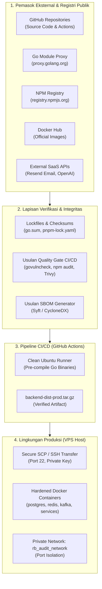

# A.5.21 Keamanan Rantai Pasok TIK

> *Ringkasan internal untuk checklist kesiapan bukti. Bukan pengganti Statement of Applicability (SoA) resmi.*

---

| Parameter | Nilai |
| :--- | :--- |
| **Tema** | Organizational |
| **Judul kontrol** | Keamanan rantai pasok TIK |
| **Fokus pemeriksaan** | Risiko sepanjang rantai pasok produk dan layanan TIK dikendalikan |
| **Contoh bukti objektif** | Supply-chain assessment, SBOM, persyaratan subkontraktor |
| **Sistem** | AuditSphere (auditsphere.app), VPS 202.10.34.160 / 202.10.34.166 dan Cloud SaaS |
| **PIC** | Lead Information Security / DevSecOps (Reza) |
| **Reviewer** | [isi saat validasi] (Dimas / Group Vision) |
| **Tanggal validasi** | [isi saat validasi] |

---

## Ringkasan Nilai untuk Checklist

| Kolom checklist | Nilai | Catatan singkat |
| :--- | :--- | :--- |
| **Relevansi SoA** | **Berlaku** | AuditSphere memanfaatkan pustaka open-source eksternal (Go, Vue/Nuxt, Python), citra kontainer Docker, infrastruktur VPS hosting, serta SaaS pihak ketiga (Resend, GitHub, OpenAI) yang memerlukan tata kelola risiko rantai pasok TIK. |
| **Status implementasi** | **Dalam proses** | Integritas dependensi dikunci via lockfile (`go.sum`, `pnpm-lock.yaml`), build Go terisolasi di CI/CD, dan panduan SCG-001 Bab 1.14 & 2.9 tersedia; namun generasi SBOM otomatis dan SCA quality gate belum aktif. |
| **Ketersediaan bukti** | **Ada sebagian** | File konfigurasi dependensi (`go.mod`, `package.json`, `requirements.txt`), pipeline CI/CD GitHub Actions, dan panduan SCG-001 tersedia; dokumen formal Asesmen Rantai Pasok, SBOM, dan NDA subkontraktor belum lengkap. |
| **Evidence ID / URL** | **Belum terdaftar** | Usulan EV-A5.21-01 s/d EV-A5.21-06 (lihat bagian 6). ID perlu didaftarkan di Master Audit Evidence Index. |
| **Efektivitas operasional** | **Sebagian efektif** | Verifikasi checksum pustaka (`go.sum` & pnpm) dan isolasi kompilasi binary berjalan efektif; namun pipeline CI/CD belum memiliki gate otomatis untuk memblokir deployment saat ditemukan dependensi rentan (CVE High/Critical). |
| **Desain kontrol** | **Perlu perbaikan** | Masih terdapat base image kontainer menggunakan tag `:latest` tanpa pinned SHA256 digest, eksekusi kontainer sebagai root, dan belum ada kebijakan formal tata kelola pengadaan serta peninjauan vendor pihak ketiga. |
| **Status kesiapan** | **Belum siap** | Bukti artefak SBOM terstandardisasi, laporan pemindaian kerentanan rantai pasok berkala, dan perjanjian kepatuhan pihak ketiga belum mencukupi untuk audit sertifikasi ISO 27001. |
| **Prioritas** | **Tinggi** | Kompromi pada pustaka atau penyedia layanan pihak ketiga (*software supply chain attack*) dapat melumpuhkan seluruh integritas sistem audit dan memicu kebocoran data kertas kerja enterprise. |
| **Review berikutnya** | **[isi]** | Usulan: 12 bulan setelah integrasi alat otomasi SBOM/SCA pada pipeline CI/CD dan ratifikasi SOP Manajemen Rantai Pasok TIK. |

---

## 1. Justifikasi Relevansi (Berlaku)

Kontrol A.5.21 **berlaku** untuk sistem AuditSphere karena:

1. **Ketergantungan Ekstensif pada Ekosistem Pustaka Open-Source**: Arsitektur backend dan frontend AuditSphere mengintegrasikan puluhan pustaka pihak ketiga (Go modules seperti Gin, Gorm, Sarama Kafka, JWT v5; Vue/Nuxt modules seperti TailwindCSS, Pinia, Zod, QRCode; serta Python libraries untuk pemodelan data). Setiap kerentanan bawaan (*vulnerabilities* / CVEs) pada dependensi tersebut secara langsung mempengaruhi postur keamanan aplikasi secara keseluruhan.
2. **Mandat Standar ISO/IEC 27001:2022 Klausul A.5.21**: Standar secara spesifik mewajibkan organisasi menetapkan dan menerapkan serangkaian proses dan prosedur untuk mengendalikan risiko keamanan informasi yang timbul sepanjang siklus rantai pasok produk dan layanan TIK, termasuk ketergantungan perangkat lunak, perangkat keras, dan komponen komputasi awan.
3. **Keterlibatan Layanan Pihak Ketiga & SaaS Eksternal Kritis**: AuditSphere memanfaatkan layanan dari entitas eksternal, mencakup penyedia VPS hosting (202.10.34.160 / 202.10.34.166), layanan pengiriman email transaksional Resend API (untuk MFA TOTP & notifikasi), GitHub Actions untuk runner CI/CD, dan penyedia model AI (OpenAI API). Keamanan data audit sangat bergantung pada integritas vendor-vendor ini.
4. **Pencegahan Serangan Siber Rantai Pasok Modern**: Tren ancaman modern seperti *dependency confusion*, *typosquatting* paket, penanaman *backdoor* pada repositori publik (*supply-chain poisoning*), dan eksploitasi layer citra kontainer yang rentan memerlukan kontrol ketat terhadap integritas dan asal-usul (*provenance*) seluruh artefak perangkat lunak.
5. **Kepatuhan Klien Enterprise & Regulasi Sektor Teratur**: Pengguna AuditSphere berasal dari kalangan perbankan, BUMN, dan korporasi terbuka yang mewajibkan kepatuhan terhadap regulasi pelindungan data pribadi (UU PDP No. 27/2022) dan standar audit internal (IIA IPPF), di mana uji kelayakan rantai pasok TIK dan transparansi komponen (SBOM) merupakan syarat mutlak dalam proses *due diligence* vendor.

---

## 2. Implementasi yang Sudah Ada

Berdasarkan penelusuran repositori `risk-based-audit`, arsitektur CI/CD, dan dokumen tata kelola keamanan, kontrol rantai pasok TIK yang telah aktif mencakup:

### 2.1 Tata Kelola Dependensi & Verifikasi Integritas Pustaka Kode
- **Penguncian Hash Kriptografis Backend Go**: Setiap microservice backend (`auth-service`, `audit-service`, `risk-service`, `master-service`, `analytics-service`) memiliki file `go.mod` dan `go.sum`. File `go.sum` mencatat hash SHA-256 untuk setiap versi modul pihak ketiga, memastikan paket yang diunduh tidak mengalami modifikasi atau injeksi kode liar saat kompilasi.
- **Penguncian Pohon Dependensi Frontend**: Repositori frontend menggunakan `pnpm-lock.yaml` yang memuat hash integritas subresource (SHA-512) untuk seluruh paket npm, mencegah inkonsistensi versi runtime antar lingkungan pengembang dan runner build.
- **Spesifikasi Modul Python Terisolasi**: Modul `backend/python-ai` mendefinisikan pustaka dependensi pihak ketiga pada `requirements.txt` untuk membatasi instalasi hanya pada paket-paket yang dibutuhkan untuk engine AI/ML.

### 2.2 Pipeline CI/CD & Build Binari Terisolasi
- **Kompilasi Binary Bersih di GitHub Runner**: Alur kerja `.github/workflows/deploy.yml` menjalankan kompilasi binary Go (`CGO_ENABLED=0 GOOS=linux GOARCH=amd64 go build -ldflags="-s -w"`) secara terisolasi pada runner `ubuntu-latest` yang bersih sebelum didistribusikan ke server target.
- **Distribusi Berkas Terenkripsi**: Paket binary dikompresi menjadi arsip `backend-dist-prod.tar.gz` dan ditransfer ke VPS produksi menggunakan protokol terenkripsi SSH/SCP (`appleboy/scp-action@v0.1.7`) dengan autentikasi kunci privat SSH rahasia yang disimpan dalam GitHub Actions Secrets.
- **Pencegahan Modifikasi Runtime**: Binary yang telah dikompilasi disalin langsung ke dalam kontainer eksekusi, meminimalisir kebutuhan perkakas build (*compiler/build-essential*) di lingkungan produksi.

### 2.3 Kontainerisasi Komponen Pihak Ketiga & Isolasi Jaringan
- **Standardisasi Citra Kontainer Resmi**: Sistem menggunakan citra resmi dari Docker Hub untuk komponen pendukung seperti `postgres:16`, `redis:7-alpine`, dan `confluentinc/cp-kafka:7.6.1` yang tercatat pada `docker-compose.prod.yml`.
- **Isolasi Jaringan Internal (`rb_audit_network`)**: Layanan database, cache, dan message broker diisolasi di dalam jaringan privat Docker dan tidak mempublikasikan port ke antarmuka publik host secara langsung, mencegah akses pihak ketiga tanpa otorisasi.
- **Konfigurasi Healthcheck Mandiri**: Kontainer dilengkapi *healthcheck* mandiri untuk memastikan layanan beroperasi secara stabil sebelum menerima lalu lintas data produksi.

### 2.4 Panduan Pengkodean Aman & Pemindaian Mandiri (SCG-001)
- **Checklist Keamanan Dependensi Go (SCG-001 Bab 1.14)**: Panduan mewajibkan eksekusi alat `govulncheck` untuk mendeteksi kerentanan pada fungsi dependensi yang dipanggil, serta `gosec` untuk analisis SAST.
- **Panduan Lockfile & Audit Frontend (SCG-001 Bab 2.9 & 2.12)**: Panduan menginstruksikan penggunaan `npm ci` dan eksekusi audit kerentanan melalui `npm audit --omit=dev --audit-level=high`.
- **Pemeriksaan CVE Dependensi Python (SCG-001 Bab 3.5)**: Panduan merekomendasikan eksekusi `pip-audit -r requirements.txt` dan `bandit` untuk mendeteksi celah keamanan pada pustaka Python.
- **Prinsip Hardening Kontainer & Workflow (SCG-001 Bab 5)**: Panduan mendokumentasikan prinsip kontainer non-root, minimal alpine, pinning digest (`@sha256:...`), dan pembatasan izin workflow token (`permissions: contents: read`).

### 2.5 Pemantauan Ketersediaan Layanan Pihak Ketiga & Observabilitas
- Mekanisme *healthcheck* otomatis pada kontainer (misal `cub zk-ready`, `redis-cli ping`, curl health endpoint) serta stack observabilitas Prometheus, Loki, dan Promtail untuk memantau performa dan ketersediaan layanan backend.

---

## 3. Identifikasi Kesenjangan (Gap Analysis)

Evaluasi terhadap implementasi aktual repositori dibandingkan klausul ISO/IEC 27001:2022 Kontrol A.5.21 dan panduan internal SCG-001 menunjukkan 8 kesenjangan utama:

| No | Parameter Rantai Pasok | Target Standar ISO 27001 & SCG-001 | Kondisi Aktual di Repositori | Status Kesenjangan |
| :-: | :--- | :--- | :--- | :-: |
| 1 | **Software Bill of Materials (SBOM)** | SBOM terstandardisasi (CycloneDX / SPDX) dihasilkan otomatis pada setiap rilis untuk melacak seluruh komponen pihak ketiga. | Belum ada mekanisme atau pipeline otomasi untuk mengekstrak dan mempublikasikan berkas SBOM dari repositori. | **Gap Teknis** (Ketiadaan SBOM) |
| 2 | **Quality Gate Pemindaian Kerentanan (SCA)** | Pipeline CI/CD wajib menjalankan pemindaian kerentanan dependensi (`govulncheck`, `npm audit`, `pip-audit`) dan memblokir deployment jika ada temuan kritis. | Perintah SCA baru tercantum di panduan SCG-001; alur kerja `deploy.yml` belum mengaktifkan pemindaian otomatis sebagai gerbang penentu (*quality gate*). | **Gap Teknis CI/CD** |
| 3 | **Pinning Citra Kontainer & Hak Eksekusi** | Dockerfile wajib menggunakan image terpin spesifik/digest (`@sha256:...`) dan menjalankan proses sebagai `USER` non-root. | Dockerfile backend menggunakan `FROM alpine:latest`, berjalan sebagai root, dan `kafka-ui` menggunakan tag `:latest` pada `docker-compose.yml`. | **Gap Hardening Kontainer** |
| 4 | **Konsistensi Lockfile Frontend** | Menggunakan satu package manager resmi dan satu lockfile terverifikasi tunggal di direktori `frontend/`. | Terdapat indikasi adanya `pnpm-lock.yaml` berdampingan dengan artefak lockfile lain, berpotensi memicu perbedaan dependensi transitif. | **Gap Manajemen Dependensi** |
| 5 | **Manajemen Rahasia pada Skrip Deploy Git** | Deploy key khusus atau SSH token yang tidak terekam dalam histori git atau file konfigurasi lokal di host target. | `deploy.yml` baris 76 & 234 masih menggunakan `x-access-token:${GH_TOKEN}` pada URL git clone, berpotensi tersimpan pada `.git/config` server VPS. | **Gap Keamanan Deploy** |
| 6 | **Kebijakan Keamanan Rantai Pasok Tertulis** | Dokumen formal Kebijakan & Prosedur Keamanan Rantai Pasok TIK (SOP-SCM-001) yang disahkan manajemen. | Belum ada dokumen SOP formal tersendiri yang mengatur siklus pengadaan, penilaian risiko vendor, dan penerimaan produk TIK pihak ketiga. | **Gap Tata Kelola / Kebijakan** |
| 7 | **Asesmen Kepatuhan Vendor SaaS & Cloud** | Review berkala laporan kepatuhan (SOC 2, ISO 27001) dan SLA vendor eksternal (Hosting VPS, Resend, OpenAI). | Belum ada catatan atau formulir penilaian risiko formal (*vendor risk assessment*) terhadap penyedia layanan cloud/SaaS. | **Gap Asesmen Vendor** |
| 8 | **Klausul Keamanan & Hak Audit Subkontraktor** | Perjanjian kerja sama pihak ketiga memuat klausul kepatuhan keamanan informasi, kerahasiaan (NDA), dan hak audit (*right-to-audit*). | Belum ada template kontrak atau berita acara kesepakatan keamanan baku untuk pihak ketiga/pengembang eksternal. | **Gap Legal / Kontrak** |

---

## 4. Bukti Objektif yang Sudah Tersedia

1. **Berkas Konfigurasi & Kunci Dependensi Go**: File `go.mod` dan `go.sum` di seluruh direktori microservice backend (`auth-service`, `audit-service`, `risk-service`, `master-service`, `analytics-service`) yang membuktikan verifikasi kriptografis modul Go.
2. **Berkas Lockfile Paket Frontend**: File `frontend/pnpm-lock.yaml` yang mencatat pohon dependensi dan nilai hash integritas seluruh paket Node.js.
3. **File Persyaratan Pustaka AI**: File `backend/python-ai/requirements.txt` yang membatasi dependensi pihak ketiga untuk microservice pemodelan data.
4. **Skrip Pipeline CI/CD**: File `.github/workflows/deploy.yml` dan `deploy-dev.yml` yang membuktikan implementasi build binary terisolasi sebelum distribusi ke VPS produksi.
5. **Definisi Layanan Kontainer Terpusat**: File `backend/docker-compose.prod.yml` yang membuktikan penggunaan image kontainer resmi dan isolasi jaringan privat `rb_audit_network`.
6. **Dokumen Panduan Pengkodean Aman (SCG-001)**: Dokumen `docs/security/SCG-001-Secure-Coding-Guide.docx` yang memuat instruksi eksekusi `govulncheck`, `npm audit`, `pip-audit`, dan prinsip hardening kontainer.

---

## 5. Bukti Objektif yang Masih Kurang

1. **SOP Kebijakan Keamanan Rantai Pasok TIK & Manajemen Vendor (SOP-SCM-001)**: Prosedur tertulis mengenai kriteria pemilihan, evaluasi risiko, pemantauan, dan terminasi vendor/produk TIK.
2. **Berkas Artefak SBOM Resmi (CycloneDX / SPDX)**: Berkas inventaris perangkat lunak mesin terbaca yang dihasilkan secara otomatis pada setiap rilis versi sistem AuditSphere.
3. **Laporan Pemindaian Kerentanan Rantai Pasok Terjadwal**: Laporan eksekusi SCA berkala (`govulncheck`, `npm audit`, `pip-audit`, Trivy image scan) yang menunjukkan status zero Critical/High CVEs.
4. **Formulir Asesmen Risiko Vendor Pihak Ketiga**: Dokumen evaluasi kelayakan dan sertifikasi kepatuhan (SOC 2, ISO 27001) untuk penyedia hosting VPS dan Resend API.
5. **Pipeline Quality Gate Terintegrasi**: Rekaman log GitHub Actions yang memperlihatkan langkah verifikasi keamanan dependensi otomatis sebagai pemblokir rilis jika terjadi pelanggaran keamanan.
6. **Template Perjanjian Kerahasiaan (NDA) & Klausul Keamanan Baku**: Dokumen legal standar untuk pihak ketiga atau pengembang eksternal yang mencakup hak audit sistem.

---

## 6. Usulan Bukti Objektif (Evidence ID)

Daftar usulan bukti objektif yang wajib diregistrasikan ke dalam Master Audit Evidence Index sistem AuditSphere:

| Evidence ID | Nama Bukti Objektif | Format / Media | Lokasi / Sumber | PIC Penyedia |
| :--- | :--- | :--- | :--- | :--- |
| **EV-A5.21-01** | SOP Kebijakan Keamanan Rantai Pasok TIK & Pengadaan Vendor | Dokumen PDF / Word | `docs/policies/SOP-SCM-001-Supply-Chain-Policy.pdf` | Lead InfoSec / Reza |
| **EV-A5.21-02** | Berkas SBOM Terstandarisasi (Format CycloneDX / SPDX) | Berkas JSON / XML | `build/reports/sbom-auditsphere-release.json` | Lead DevOps / Reza |
| **EV-A5.21-03** | Laporan Hasil Pemindaian Kerentanan SCA & Citra Kontainer | Laporan PDF / Artifact | GitHub Actions Security Scan Logs / Trivy Reports | DevSecOps Engineer |
| **EV-A5.21-04** | Berkas Asesmen Risiko & Sertifikat Kepatuhan Vendor SaaS | Dokumen PDF Asesmen | `docs/compliance/vendor-assessments-2026.pdf` | Lead InfoSec / Dimas |
| **EV-A5.21-05** | Konfigurasi CI/CD Quality Gate & Hardening Workflow | Kode YAML & Run Logs | `.github/workflows/deploy.yml` & `security-scan.yml` | Lead DevOps |
| **EV-A5.21-06** | Perjanjian Kerahasiaan (NDA) & Klausul Keamanan Pihak Ketiga | Berkas Legal Bertanda Tangan | Legal Repository / Jira Contract Management | Legal & Compliance |

---

## 7. Rencana Aksi Perbaikan (Action Plan)

Rencana aksi terstruktur guna menutup seluruh kesenjangan kontrol A.5.21 dalam kurun waktu 4 minggu ke depan:

| No | Tindakan Remediasi / Peningkatan | Target Luaran Teknis | PIC | Target Waktu |
| :-: | :--- | :--- | :--- | :-: |
| 1 | **Penyusunan & Pengesahan SOP Keamanan Rantai Pasok (SOP-SCM-001)** | Dokumen formal SOP pengadaan, kriteria due diligence vendor, dan klausul keamanan | Reza / Dimas | 2 minggu |
| 2 | **Integrasi Pembuatan SBOM Otomatis pada CI/CD** | Penambahan step Syft / CycloneDX CLI di GitHub Actions untuk merilis `sbom.json` tiap build | DevOps Engineer | 1 minggu |
| 3 | **Pengaktifan SCA Quality Gate Pemindaian Dependensi** | Integrasi `govulncheck`, `npm audit`, dan `pip-audit` sebagai blocking step di workflow `deploy.yml` | DevSecOps | 2 minggu |
| 4 | **Hardening Dockerfile & Pinning Digest Base Image** | Penggantian `alpine:latest` dengan image terpin `@sha256:...` serta penambahan `USER` non-root | Backend Engineer | 2 minggu |
| 5 | **Konsolidasi Lockfile Frontend & Pembersihan Duplikasi** | Penetapan `pnpm-lock.yaml` sebagai lockfile tunggal resmi dan penghapusan lockfile lain | Frontend Engineer | 1 minggu |
| 6 | **Remediasi Manajemen Token Git pada Skrip Deploy** | Penggantian URL clone token `x-access-token` dengan SSH Deploy Key terdedikasi tanpa jejak log | DevOps Engineer | 1 minggu |
| 7 | **Pelaksanaan Due Diligence & Asesmen Risiko Vendor SaaS** | Pengisian formulir asesmen vendor untuk penyedia VPS hosting dan Resend API | Lead InfoSec | 3 minggu |
| 8 | **Standarisasi Template NDA & Klausul Hak Audit** | Pembuatan dokumen baku perjanjian kerahasiaan dan hak audit untuk pihak ketiga | Legal / Compliance | 2 minggu |

---

*Dokumen ini disusun untuk melengkapi kepatuhan sistem AuditSphere terhadap standar ISO/IEC 27001:2022 Klausul Annex A.5.21.*

