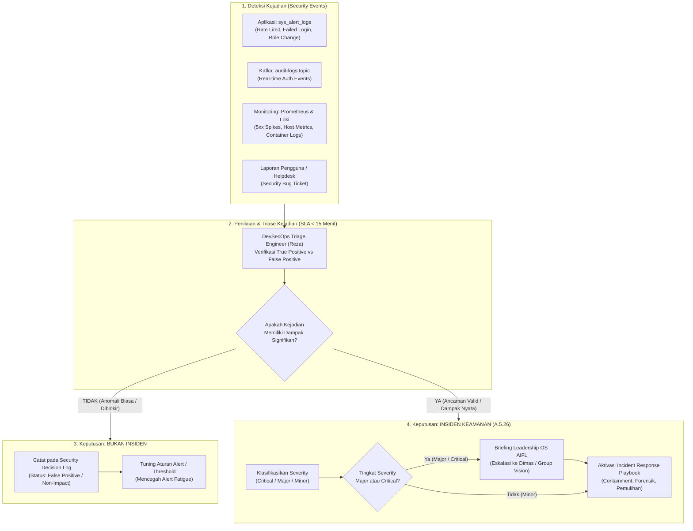

# A.5.25 Penilaian Kejadian Keamanan

> *Ringkasan internal untuk checklist kesiapan bukti. Bukan pengganti Statement of Applicability (SoA) resmi.*

---

| Parameter | Nilai |
| :--- | :--- |
| **Tema** | Organizational |
| **Judul kontrol** | Penilaian kejadian keamanan |
| **Fokus pemeriksaan** | Event dinilai konsisten untuk menentukan apakah menjadi insiden |
| **Contoh bukti objektif** | Kriteria klasifikasi, event ticket, decision log, SLA triage |
| **Sistem** | AuditSphere (auditsphere.app), VPS 202.10.34.160 / 202.10.34.166 dan Cloud SaaS |
| **PIC** | Lead Information Security / DevSecOps (Reza) |
| **Reviewer** | [isi saat validasi] (Dimas / Group Vision) |
| **Tanggal validasi** | [isi saat validasi] |

---

## Ringkasan Nilai untuk Checklist

| Kolom checklist | Nilai | Catatan singkat |
| :--- | :--- | :--- |
| **Relevansi SoA** | **Berlaku** | Penilaian dan triase kejadian keamanan (*security events*) wajib diterapkan secara konsisten guna memastikan anomali sistem dan ancaman terdeteksi dan dipilah secara akurat sebelum berkembang menjadi insiden siber yang melumpuhkan AuditSphere. |
| **Status implementasi** | **Dalam proses** | Infrastruktur penangkap event aktif melalui Prometheus, Loki, Promtail, Kafka `audit-logs`, dan tabel `sys_alert_logs`; serta kerangka eskalasi Leadership OS dan SLA < 15 menit telah didesain di ISO-AS-001 Bab 11, namun formulir triase otomatis belum terintegrasi. |
| **Ketersediaan bukti** | **Ada sebagian** | Tabel `sys_alert_logs`, pipeline logging Loki/Promtail, konfigurasi scrape Prometheus, dan panduan eskalasi Leadership OS di ISO-AS-001 tersedia; SOP Penilaian & Triase Kejadian Keamanan formal, Decision Log, dan tiket triase terpusat belum lengkap. |
| **Evidence ID / URL** | **Belum terdaftar** | Usulan EV-A5.25-01 s/d EV-A5.25-06 (lihat bagian 6). ID perlu didaftarkan di Master Audit Evidence Index. |
| **Efektivitas operasional** | **Sebagian efektif** | Pengumpulan log aktivitas audit dan peringatan keamanan melalui Kafka dan stack monitoring berjalan baik; namun proses pemilahan (triase) event menjadi insiden masih dilakukan secara ad-hoc tanpa rekaman *decision log* baku. |
| **Desain kontrol** | **Perlu perbaikan** | Prometheus belum dilengkapi berkas aturan peringatan otomatis (`alerting_rules.yml`) dengan integrasi notifikasi real-time (webhook / Telegram / PagerDuty) untuk memicu proses triase langsung saat anomali terdeteksi. |
| **Status kesiapan** | **Belum siap** | Prosedur operasional baku penilaian kejadian keamanan, formulir kriteria triase (*true vs false positive*), dan rekam jejak keputusan insiden belum terdokumentasi lengkap untuk audit sertifikasi ISO 27001. |
| **Prioritas** | **Tinggi** | Penilaian kejadian keamanan adalah gerbang utama manajemen insiden; kegagalan triase dapat menyebabkan insiden kritis (seperti *data breach* atau kompromi admin) terlambat ditangani dan berakibat fatal. |
| **Review berikutnya** | **[isi]** | Usulan: 12 bulan setelah pengesahan SOP Penilaian Kejadian Keamanan dan pengaktifan modul otomatisasi triase peringatan keamanan di sistem monitoring. |

---

## 1. Justifikasi Relevansi (Berlaku)

Kontrol A.5.25 **berlaku** untuk sistem AuditSphere karena:

1. **Pemisahan Tegas Antara Kejadian (Event) dan Insiden (Incident)**: Sistem AuditSphere memproses ribuan transaksi, pemanggilan API, dan autentikasi setiap hari yang menghasilkan berbagai kejadian keamanan (*security events*), seperti lonjakan percobaan login gagal, pembatasan rate limit oleh Kong Gateway, dan perubahan hak akses peran. Diperlukan proses penilaian yang konsisten untuk membedakan anomali operasional biasa (*false positive*) dari serangan nyata (*true positive*) yang berpotensi menjadi insiden siber.
2. **Mandat Standar ISO/IEC 27001:2022 Klausul A.5.25**: Standar mensyaratkan organisasi untuk menilai kejadian keamanan informasi dan memutuskan apakah kejadian tersebut dikategorikan sebagai insiden keamanan informasi, guna mencegah penanganan yang berlebihan (*alert fatigue*) pada event non-kritis atau pengabaian pada insiden yang berdampak fatal.
3. **Perlindungan Terhadap Kerahasiaan Kertas Kerja Audit (KKA & LHA)**: AuditSphere mengelola data audit rahasia (*Confidential* dan *Restricted*) korporasi dan perbankan. Kejadian anomali yang melibatkan akses data tidak wajar harus dinilai secara instan dengan kriteria dampak terukur untuk mencegah kebocoran informasi temuan audit dan indikasi fraud.
4. **Pemenuhan SLA Tanggap Insiden Sesuai ISO-AS-001 Bab 11**: Dokumen keselarasan keamanan menetapkan target waktu triase awal < 15 menit untuk memvalidasi kejadian sebelum eskalasi ke Leadership (Dimas / Group Vision), yang hanya dapat dicapai apabila kriteria penilaian, alur verifikasi, dan matriks keparahan telah didefinisikan secara baku.
5. **Pencegahan "Alert Fatigue" dan Optimalisasi Sumber Daya DevSecOps**: Dengan tim keamanan yang terfokus (Reza & SecOps), ketiadaan kriteria penilaian yang objektif dapat mengakibatkan kelelahan peringatan (*alert fatigue*) akibat ratusan notifikasi log yang tidak terklasifikasi, sehingga mengaburkan ancaman nyata yang sedang berlangsung.

---

## 2. Implementasi yang Sudah Ada

Berdasarkan penelusuran repositori `risk-based-audit`, arsitektur monitoring, dan dokumen tata kelola keamanan, kontrol penilaian kejadian keamanan yang telah berjalan meliputi:

### 2.1 Struktur Data Pencatatan Alert Sistem (`sys_alert_logs`)
- **Model Data Peringatan Keamanan Terstruktur**: Entitas `backend/auth-service/models/sys_alert_log.go` mendefinisikan enumerasi `SysAlertAction` yang mencatat kejadian keamanan spesifik pada tingkat aplikasi, antara lain:
  - `sys_alert_login_log`: Login pengguna berhasil.
  - `sys_alert_logout_log`: Logout pengguna.
  - `sys_alert_failed_attempt_log`: Percobaan autentikasi gagal.
  - `sys_alert_change_permission_log`: Perubahan hak akses peran.
  - `sys_alert_locked_out`: Penguncian akun akibat kegagalan berulang.
  - `sys_alert_role_assigned_log` & `sys_alert_role_revoked_log`: Alokasi/pencabutan peran.
  - `sys_alert_rate_limit_exceeded_log`: Pelanggaran batas laju trafik (Kong API Gateway).
  - `sys_alert_password_reset_requested_log` & `sys_alert_password_reset_completed_log`: Siklus reset kredensial.
- **Perekaman Konteks Kejadian**: Setiap rekaman `sys_alert_logs` menyimpan `UserID`, `Action`, `IPAddress`, serta stempel waktu `CreatedAt` guna mempermudah analisis korelasi kejadian saat proses triase dilakukan.
- **Akses Repositori Terstandarisasi**: File `backend/auth-service/repositories/sys_alert_log_repository.go` menyediakan fungsi pencarian `FindByAction`, `FindByIPAddress`, dan `CountByAction` untuk menganalisis frekuensi kejadian anomali per alamat IP atau tipe aksi.

### 2.2 Streaming Kejadian Real-Time via Apache Kafka
- **Penerbitan Event Asinkronus**: Layanan `backend/auth-service/services/auth/auth_service.go` mempublikasikan seluruh kejadian autentikasi ke broker Apache Kafka dengan topik `audit-logs`, mencakup event `auth.login_success`, `auth.login_failed`, `auth.logout`, `auth.password_changed`, dan `auth.mfa_enabled`.
- **Audit Trail yang Tidak Dapat Diubah (Immutability)**: Pesan event pada Kafka dikonfigurasi dengan retensi 168 jam (7 hari) pada `backend/docker-compose.prod.yml`, memberikan jendela waktu yang memadai bagi tim DevSecOps untuk mengkaji riwayat kejadian keamanan sebelum mengambil keputusan insiden.

### 2.3 Stack Observabilitas & Pemantauan Sentral (Prometheus, Loki, Grafana)
- **Pengumpulan Metrik Infrastruktur & Gateway**: File `monitoring/prometheus/prometheus.yml` melakukan scraping metrik setiap 15 detik terhadap Node Exporter (CPU, RAM, Disk, Jaringan VPS 202.10.34.166) serta endpoint metrik Kong API Gateway (`rb_audit_kong:8001/metrics`).
- **Agregasi Log Kontainer & Syslog melalui Promtail & Loki**: File `monitoring/promtail/promtail-config.yml` secara aktif mengumpulkan seluruh log dari kontainer Docker (`/var/lib/docker/containers/*/*-json.log`) dan syslog host (`/var/log/messages`) untuk dikirimkan ke Loki (`rbia_loki:3100`), memungkinkan pencarian log sentral saat terjadi investigasi kejadian.
- **Visualisasi Operasional Grafana**: Dasbor Grafana (port 9300) dikonfigurasi dengan sumber data Prometheus dan Loki untuk memantau lonjakan tingkat kesalahan (HTTP 5xx), anomali konsumsi sumber daya, dan tren akses sistem.

### 2.4 Kerangka Triase, Matriks Keparahan & Format Leadership OS (ISO-AS-001 Bab 11)
- **Standar Waktu Triase Awal**: Dokumen `docs/DOKUMEN_KESELARASAN_ISO27001.md` Bab 11.1 menetapkan tahapan Triage Awal < 15 menit oleh Tim Security/Ops untuk memvalidasi apakah suatu kejadian merupakan *true positive* atau *false positive*.
- **Matriks Klasifikasi 3 Tingkat (Bab 11.3)**: Telah dirumuskan kriteria tingkat keparahan insiden:
  1. **Critical**: Kebocoran data rahasia klien (*data breach*), sistem lumpuh total (*total outage*), kompromi akun root/admin, ransomware. SLA respons < 15 menit (Eskalasi segera ke Group Vision).
  2. **Major**: Kerentanan *high-severity* aktif tereksploitasi, kegagalan fungsi modul inti audit, anomali akses lintas tenant yang tertahan. SLA respons < 1 jam.
  3. **Minor**: Percobaan brute force yang berhasil diblokir, bug UI non-kritis, kegagalan pengiriman notifikasi email audit. SLA respons < 4 jam.
- **Format Briefing Eskalasi Leadership OS AIFL (Bab 11.2)**: Untuk insiden dengan dampak Major atau Critical, telah ditetapkan format eskalasi terstandarisasi mencakup:
  ```text
  [LEADERSHIP OS INCIDENT BRIEFING FORMAT]
  1. CONTEXT        : Latar belakang singkat sistem/komponen yang terdampak dan waktu kejadian.
  2. PROBLEM        : Deskripsi jelas mengenai insiden keamanan yang terjadi.
  3. IMPACT         : Dampak aktual & potensial terhadap data klien, reputasi, operasional, dan kepatuhan.
  4. OPTIONS        : 2–3 opsi tindakan mitigasi yang dapat diambil beserta kelebihan & kekurangannya.
  5. RECOMMENDATION : Rekomendasi tindakan terbaik dari Tim Keamanan & Engineering.
  6. DECISION       : Keputusan atau arahan persetujuan yang dibutuhkan dari Leadership.
  ```



---

## 3. Identifikasi Kesenjangan (Gap Analysis)

Perbandingan antara kondisi implementasi di repositori dengan klausul ISO/IEC 27001:2022 Kontrol A.5.25 dan rancangan ISO-AS-001 menunjukkan 8 kesenjangan utama:

| No | Parameter Penilaian Kejadian | Target Standar ISO 27001 & ISO-AS-001 | Kondisi Aktual di Repositori | Status Kesenjangan |
| :-: | :--- | :--- | :--- | :-: |
| 1 | **Prosedur Triase Formal (SOP-SEC-005)** | Tersedia SOP tertulis yang mengatur langkah-langkah penilaian, kriteria penentuan insiden, dan peran penilai. | Prosedur baru tercantum sebagai konsep ringkas pada Bab 11 ISO-AS-001; belum ada dokumen SOP formal tersendiri bertanda tangan. | **Gap Dokumentasi** |
| 2 | **Log Pengambilan Keputusan (Decision Log)** | Setiap kejadian keamanan yang dinilai dicatat dalam decision log resmi yang memuat status "Insiden: Ya/Tidak" dan alasan. | Kejadian hanya tercatat sebagai log mentah di Kafka, Loki, dan `sys_alert_logs` tanpa rekaman keputusan triase terstruktur. | **Gap Teknis** (Ketiadaan Decision Log) |
| 3 | **Aturan Alerting Otomatis di Prometheus** | Prometheus dilengkapi `alerting_rules.yml` untuk mendeteksi anomali (brute force spike, 5xx spike, container down) secara otomatis. | File `prometheus.yml` baru memuat `scrape_configs`; belum ada aturan alert (`alerting_rules`) dan integrasi Alertmanager. | **Gap Otomasi Monitoring** |
| 4 | **Kanal Notifikasi Eskalasi Real-Time** | Notifikasi alert keamanan otomatis terkirim instan ke kanal komunikasi tim (Telegram / Slack / Webhook) untuk memicu triase. | Belum ada webhook atau bot notifikasi yang menghubungkan sistem monitoring/alert logs ke kanal komunikasi tim siaga. | **Gap Integrasi Alert** |
| 5 | **Formulir Triase & Verifikasi Kejadian** | Tersedia checklist/kuesioner terstandarisasi untuk memverifikasi true positive vs false positive secara konsisten. | Verifikasi kejadian masih bergantung pada inisiatif personal engineer tanpa panduan kuesioner verifikasi yang baku. | **Gap Tata Kelola Operasional** |
| 6 | **Pengukuran Kinerja SLA Triase (MTTT)** | SLA triase (< 15 menit) diukur, dicatat, dan dievaluasi berkala menggunakan metrik Mean Time to Triage (MTTT). | Waktu respons triase belum diukur dan belum dicatat dalam laporan metrik bulanan keamanan informasi. | **Gap Pengukuran Kinerja** |
| 7 | **Korelasi Event Otomatis pada `sys_alert_logs`** | Sistem secara otomatis mengelompokkan kejadian berulang (misal > 5 failed attempts dari IP sama) menjadi satu tiket triase. | Tabel `sys_alert_logs` hanya mencatat baris log individual tanpa mesin korelasi atau penandaan status tiket penanganan. | **Gap Fitur Aplikasi** |
| 8 | **Simulasi Penilaian Kejadian (Tabletop Drill)** | Dilakukan latihan simulasi triase kejadian keamanan minimal setiap 6 bulan untuk menguji ketepatan penilaian tim. | Belum pernah diselenggarakan latihan simulasi penilaian kejadian keamanan formal yang menghasilkan berita acara. | **Gap Pengujian Kesiapan** |

---

## 4. Bukti Objektif yang Sudah Tersedia

1. **Struktur Model Alert Sistem (`sys_alert_logs`)**: File `backend/auth-service/models/sys_alert_log.go` yang memuat definisi 10 aksi alert keamanan sistem.
2. **Repositori Pengelolaan Log Alert**: File `backend/auth-service/repositories/sys_alert_log_repository.go` yang menyediakan metode pencarian event berdasarkan aksi, IP, dan pengguna.
3. **Streaming Log Audit Trail Kafka**: File `backend/auth-service/services/auth/auth_service.go` yang mempublikasikan event autentikasi secara real-time ke topik Kafka `audit-logs`.
4. **Konfigurasi Pemantauan Metrik Prometheus**: File `monitoring/prometheus/prometheus.yml` yang mengumpulkan metrik performa VPS host dan Kong API Gateway.
5. **Konfigurasi Agregasi Log Promtail & Loki**: File `monitoring/promtail/promtail-config.yml` dan `monitoring/docker-compose.monitoring.yml` yang mengumpulkan seluruh log kontainer Docker.
6. **Kerangka Kerja Insiden & Eskalasi Leadership OS**: Dokumen `docs/DOKUMEN_KESELARASAN_ISO27001.md` Bab 11 yang memuat matriks klasifikasi tingkat keparahan, SLA triase < 15 menit, dan format briefing Leadership OS.

---

## 5. Bukti Objektif yang Masih Kurang

1. **SOP Prosedur Penilaian & Triase Kejadian Keamanan Informasi (SOP-SEC-005)**: Dokumen formal yang disahkan manajemen mengenai alur kerja triase, kriteria klasifikasi, dan eskalasi.
2. **Matriks Kriteria Penentuan Kejadian vs Insiden (Event-to-Incident Decision Matrix)**: Tabel referensi cepat untuk menentukan apakah anomali sistem dikategorikan sebagai Insiden atau Event Biasa.
3. **Buku Log Keputusan Triase Keamanan (Security Event Decision Log)**: Formulir/sheet rekam jejak penilaian kejadian yang memuat tanggal, sumber event, verifikasi true/false positive, keputusan, dan tanda tangan penilai.
4. **Berkas Aturan Peringatan Monitoring (Prometheus Alerting Rules & Alertmanager)**: File konfigurasi rules di Prometheus dan webhook notifikasi ke bot Telegram/Slack tim siaga.
5. **Laporan Pengukuran Metrik Triase (Mean Time to Triage / MTTT)**: Laporan bulanan yang mencatat rata-rata kecepatan triase dan persentase false positive.
6. **Berita Acara Simulasi Triase Kejadian Keamanan (Tabletop Drill Report)**: Bukti pelaksanaan latihan evaluasi kesiapan tim dalam menilai kejadian keamanan fiktif.

---

## 6. Usulan Bukti Objektif (Evidence ID)

Daftar usulan bukti objektif yang wajib diregistrasikan ke dalam Master Audit Evidence Index sistem AuditSphere:

| Evidence ID | Nama Bukti Objektif | Format / Media | Lokasi / Sumber | PIC Penyedia |
| :--- | :--- | :--- | :--- | :--- |
| **EV-A5.25-01** | SOP Penilaian & Triase Kejadian Keamanan (SOP-SEC-005) | Dokumen PDF / Word | `docs/policies/SOP-SEC-005-Security-Event-Assessment.pdf` | Lead InfoSec / Reza |
| **EV-A5.25-02** | Matriks Kriteria Klasifikasi Kejadian vs Insiden | Dokumen PDF / Poster Meja | `docs/security/Event-Incident-Classification-Matrix.pdf` | Lead InfoSec / Reza |
| **EV-A5.25-03** | Buku Log Keputusan Triase Kejadian (Decision Log) | Spreadsheet / Jira Board | SecOps Management Portal / Decision Log Register | DevSecOps Engineer |
| **EV-A5.25-04** | Konfigurasi Aturan Alerting & Integrasi Notifikasi | Kode YAML & Config | `monitoring/prometheus/alerting_rules.yml` & `alertmanager.yml` | Lead DevOps |
| **EV-A5.25-05** | Sampel Log Kejadian Sistem & Rekaman Triase | Ekspor JSON / CSV | PostgreSQL `sys_alert_logs` & Kafka `audit-logs` sample | DevSecOps Engineer |
| **EV-A5.25-06** | Berita Acara Simulasi Triase Kejadian Keamanan | Dokumen PDF Bertanda Tangan | `docs/security/reports/Tabletop-Triage-Drill-2026.pdf` | Reza / Dimas |

---

## 7. Rencana Aksi Perbaikan (Action Plan)

Rencana aksi terstruktur guna menutup seluruh kesenjangan kontrol A.5.25 dalam kurun waktu 3 minggu ke depan:

| No | Tindakan Remediasi / Peningkatan | Target Luaran Teknis | PIC | Target Waktu |
| :-: | :--- | :--- | :--- | :-: |
| 1 | **Penyusunan & Pengesahan SOP Penilaian Kejadian Keamanan** | Dokumen formal SOP-SEC-005 yang memuat definisi event vs incident, alur triase, dan eskalasi | Reza / Dimas | 2 minggu |
| 2 | **Pembuatan Matriks Kriteria Keputusan Event vs Insiden** | Matriks acuan cepat berisi parameter kerahasiaan, integritas, dan ketersediaan | Lead InfoSec | 1 minggu |
| 3 | **Penyediaan Formulir & Register Decision Log Terpusat** | Register spreadsheet/portal untuk mendokumentasikan hasil penilaian setiap event keamanan | DevSecOps | 1 minggu |
| 4 | **Penyusunan Berkas Alerting Rules pada Prometheus** | Pembuatan file `monitoring/prometheus/alerting_rules.yml` untuk anomali trafik, error rate, dan host | DevOps Engineer | 2 minggu |
| 5 | **Integrasi Kanal Notifikasi Alert Real-Time** | Setup Alertmanager dengan webhook notifikasi bot Telegram/Slack untuk tim siaga keamanan | DevOps Engineer | 2 minggu |
| 6 | **Pengembangan Endpoint / UI Ringkasan SysAlertLog** | Antarmuka atau query dashboard internal untuk mempermudah triage kejadian keamanan | Backend Dev | 2 minggu |
| 7 | **Pengukuran & Pelaporan Metrik SLA Triase (MTTT)** | Laporan berkala kecepatan respon triase (< 15 menit) dan rasio false positive | Lead InfoSec | 3 minggu |
| 8 | **Pelaksanaan Simulasi Tabletop Triase Kejadian Keamanan** | Sesi latihan triase skenario fiktif (misal brute force massal atau anomali token) dan berita acara | Reza / Dimas | 3 minggu |

---

*Dokumen ini disusun untuk melengkapi kepatuhan sistem AuditSphere terhadap standar ISO/IEC 27001:2022 Klausul Annex A.5.25.*

