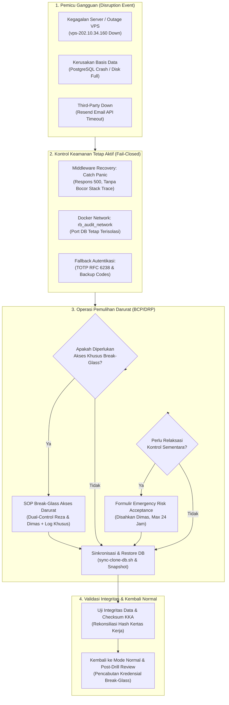

# A.5.29 Keamanan Selama Gangguan

> *Ringkasan internal untuk checklist kesiapan bukti. Bukan pengganti Statement of Applicability (SoA) resmi.*

---

| Parameter | Nilai |
| :--- | :--- |
| **Tema** | Organizational |
| **Judul kontrol** | Keamanan selama gangguan |
| **Fokus pemeriksaan** | Keamanan informasi dipertahankan pada kondisi gangguan |
| **Contoh bukti objektif** | BCP, prosedur mode darurat, hasil latihan, risk acceptance |
| **Sistem** | AuditSphere (auditsphere.app), VPS 202.10.34.160 / 202.10.34.166 dan Cloud SaaS |
| **PIC** | Lead Information Security / DevSecOps (Reza) |
| **Reviewer** | [isi saat validasi] (Dimas / Group Vision) |
| **Tanggal validasi** | [isi saat validasi] |

---

## Ringkasan Nilai untuk Checklist

| Kolom checklist | Nilai | Catatan singkat |
| :--- | :--- | :--- |
| **Relevansi SoA** | **Berlaku** | Keamanan informasi wajib dipertahankan selama masa krisis, bencana, atau pemadaman sistem guna menjamin data KKA/LHA tetap terlindungi dan kendali akses tidak dilonggarkan tanpa otorisasi. |
| **Status implementasi** | **Dalam proses** | Desain target RTO/RPO terukur dicatat pada ISO-AS-001 Bab 12, middleware recovery *fail-closed* aktif, dan mekanisme kloning database tersedia; namun BCP formal, SOP Break-Glass, dan formulir penerimaan risiko darurat belum lengkap. |
| **Ketersediaan bukti** | **Ada sebagian** | Skrip kloning `sync-clone-db.sh`, middleware recovery panic, konfigurasi Patroni/DB replikasi, dan dokumen arsitektur BCM tersedia; dokumen BCP formal terintegrasi keamanan, rekam jejak drill uji coba, dan formulir emergency risk acceptance belum disahkan. |
| **Evidence ID / URL** | **Belum terdaftar** | Usulan EV-A5.29-01 s/d EV-A5.29-06 (lihat bagian 6). ID perlu didaftarkan di Master Audit Evidence Index. |
| **Efektivitas operasional** | **Sebagian efektif** | Pola penanganan error *fail-closed* pada microservices dan isolasi jaringan privat Docker berjalan efektif; namun tata kelola operasi mode darurat dan pemulihan data dari cadangan belum diuji secara berkala. |
| **Desain kontrol** | **Perlu perbaikan** | Skrip sinkronisasi basis data cadangan masih menyertakan kredensial default terbuka, belum ada mekanisme log audit independen untuk akses darurat (*break-glass*), dan belum ada *fallback logging* saat Kafka terputus. |
| **Status kesiapan** | **Belum siap** | Pedoman Business Continuity Plan (BCP) yang mengintegrasikan persyaratan keamanan informasi, SOP operasi darurat, dan bukti latihan pemulihan sistem belum memenuhi kriteria audit sertifikasi ISO 27001. |
| **Prioritas** | **Tinggi** | Kondisi gangguan merupakan periode paling rentan; relaksasi kontrol keamanan yang tidak terkendali saat krisis dapat dimanfaatkan penyerang untuk mengekstraksi data kertas kerja audit internal. |
| **Review berikutnya** | **[isi]** | Usulan: 12 bulan setelah pengesahan dokumen BCP Keamanan Informasi dan pelaksanaan simulasi uji coba pemulihan darurat. |

---

## 1. Justifikasi Relevansi (Berlaku)

Kontrol A.5.29 **berlaku** untuk sistem AuditSphere karena:

1. **Perlindungan Kerahasiaan Dokumen KKA & LHA Saat Krisis**: Saat terjadi insiden kegagalan sistem, pemadaman server VPS, atau bencana alam, data audit sensitif (temuan investigasi kecurangan, KKA, data perbankan auditee) berisiko bocor apabila kontrol keamanan dilonggarkan atau dipintas demi mempercepat pemulihan ketersediaan.
2. **Mandat Standar ISO/IEC 27001:2022 Klausul A.5.29**: Standar mewajibkan organisasi merencanakan, menetapkan, dan memelihara tingkat keamanan informasi yang tepat selama kondisi gangguan atau operasi mode darurat, menjamin prinsip *Confidentiality*, *Integrity*, dan *Availability* tetap seimbang.
3. **Pencegahan Akses Darurat Tanpa Akuntabilitas (Break-Glass)**: Dalam kondisi darurat pemeliharaan atau pemulihan bencana, akses administratif langsung (*root access*) ke basis data dan kontainer produksi sering kali diperlukan. Tanpa prosedur *break-glass* yang ketat, tindakan administratif tidak dapat diaudit dan rentan penyalahgunaan wewenang.
4. **Penetapan Batasan Penerimaan Risiko Darurat (Emergency Risk Acceptance)**: Jika suatu kontrol keamanan terpaksa dinonaktifkan sementara selama gangguan (misal bypass filter WAF yang memblokir lalu lintas pemulihan), keputusan tersebut harus melalui proses otorisasi formal oleh pimpinan (Dimas / Group Vision) dengan masa berlaku dan mitigasi kompensasi yang jelas.
5. **Penyelarasan dengan Target RTO/RPO Korporasi**: Dokumen ISO-AS-001 Bab 12 menetapkan *Recovery Time Objective* (RTO) < 1 jam untuk database dan < 30 menit untuk microservices. Proses pemulihan cepat ini harus dieksekusi tanpa mengorbankan integritas data atau membuka port database ke jaringan publik.

---

## 2. Implementasi yang Sudah Ada

Berdasarkan penelusuran repositori `risk-based-audit`, arsitektur microservices, dan dokumen keselarasan keamanan, implementasi perlindungan selama gangguan meliputi:

### 2.1 Desain Arsitektur Fail-Closed & Penanganan Panic Terisolasi
- **Middleware Penanganan Kegagalan (Recovery Middleware)**: File `backend/auth-service/pkg/middleware/recovery.go`, `audit-service`, dan `master-service` menerapkan mekanisme `defer recover()` untuk menangkap panic pada runtime aplikasi. Jika terjadi kegagalan tak terduga, sistem mencatat stack trace pada logger internal terisolasi dan mengembalikan respons HTTP 500 generik tanpa membocorkan struktur internal sistem atau informasi sensitif ke pengguna publik.
- **Penolakan Akses Otomatis (Fail-Closed)**: Saat terjadi gangguan pada modul validasi otentikasi atau basis data, API Gateway dan middleware menolak permintaan akses secara otomatis, mencegah akses tidak sah terbuka dalam kondisi anomali.

### 2.2 Prosedur Replikasi & Kloning Data Cadangan
- **Infrastruktur Kontainer Kloning Basis Data**: Berkas `backend/docker-compose.clone-db.yml` mendefinisikan kontainer sekunder `rb_audit_postgres_clone` yang beroperasi pada port terisolasi 5435 dengan volume terpisah `postgres_clone_data`.
- **Skrip Sinkronisasi Data Otomatis**: Skrip `backend/scripts/sync-clone-db.sh` memfasilitasi replikasi data aktif dari kontainer produksi `rb_audit_postgres` ke kontainer kloning menggunakan pipa `docker exec pg_dumpall | psql`, memungkinkan pemulihan cepat data operasional jika basis data utama mengalami kerusakan.

### 2.3 Kontrol Autentikasi Fallback Multi-Factor & Kunci Cadangan
- **Penyediaan Backup Codes Terenkripsi**: Pada `backend/auth-service/models/user.go`, entitas `MFASetup` menyediakan `BackupCodes` yang di-hash dan disimpan terenkripsi. Jika layanan pihak ketiga (Resend Email API) mengalami gangguan jaringan eksternal, pengguna tetap dapat menyelesaikan autentikasi multi-faktor menggunakan aplikasi TOTP offline (Google Authenticator) atau kode cadangan tanpa menurunkan tingkat keamanan sistem.

### 2.4 Isolasi Jaringan Tetap Aktif Selama Gangguan
- **Pemeliharaan Perimeter Jaringan (`rb_audit_network`)**: Seluruh proses sinkronisasi kloning dan pemulihan layanan dilakukan di dalam Docker network privat. Meskipun sistem sedang mengalami gangguan atau proses pemulihan berjalan, port basis data utama tetap tidak dipublikasikan ke antarmuka publik host, menjaga keamanan data dari pemindaian eksternal.

### 2.5 Kerangka Kerja RTO/RPO & BCM di ISO-AS-001 Bab 12
- **Target Pemulihan Terukur**: Dokumen `docs/DOKUMEN_KESELARASAN_ISO27001.md` Bab 12.1 mendokumentasikan matriks RTO dan RPO untuk setiap tier arsitektur: Core Database (RTO < 1 Jam, RPO < 15 Menit), Application Services (RTO < 30 Menit, RPO 0), AI Service (RTO < 2 Jam), dan Storage Bukti Audit (RTO < 2 Jam).
- **Jadwal Pencadangan & Drill**: Bab 12.2 menetapkan snapshot harian basis data pukul 02:00 WIB serta mandat pelaksanaan drill test pemulihan bencana minimal 1 kali setiap 6 bulan.

---

## 3. Identifikasi Kesenjangan (Gap Analysis)

Evaluasi kesesuaian implementasi aktual terhadap klausul ISO/IEC 27001:2022 Kontrol A.5.29 menunjukkan 8 kesenjangan yang harus ditangani:

| No | Parameter Keamanan Gangguan | Target Standar ISO 27001 & ISO-AS-001 | Kondisi Aktual di Repositori | Status Kesenjangan |
| :-: | :--- | :--- | :--- | :-: |
| 1 | **Dokumen Formal BCP Keamanan Informasi** | Tersedia dokumen Business Continuity Plan (BCP-SEC-001) yang mengintegrasikan aspek keamanan informasi saat darurat. | Baru tersedia ringkasan target RTO/RPO di Bab 12 ISO-AS-001; belum ada dokumen BCP formal bertanda tangan. | **Gap Tata Kelola / Dokumen** |
| 2 | **Prosedur Akses Darurat (Break-Glass)** | Prosedur tertulis mengenai mekanisme pembukaan akses darurat dengan akun terisolasi, dual-control, dan audit trail khusus. | Belum ada prosedur baku break-glass; penanganan gangguan masih mengandalkan akses terminal langsung oleh administrator. | **Gap Prosedur Akses** |
| 3 | **Formulir Penerimaan Risiko Darurat** | Formulir otorisasi formal (Emergency Risk Acceptance) jika kontrol keamanan harus dilonggarkan sementara saat krisis. | Belum ada template formulir penerimaan risiko darurat dan batas waktu kedaluwarsa otorisasi. | **Gap Tata Kelola Risiko** |
| 4 | **Kredensial Default pada Skrip Sinkronisasi** | Skrip otomatisasi pemulihan menggunakan kredensial aman dari environment secrets tanpa nilai default terbuka. | Skrip `sync-clone-db.sh` masih mencantumkan kredensial default terbuka `postgres:postgres` dan port 5435 terbuka. | **Gap Keamanan Skrip** |
| 5 | **Fallback Audit Trail Saat Kafka Gangguan** | Mekanisme cadangan pencatatan audit log ke database/file terenkripsi lokal saat broker Kafka tidak dapat dihubungi. | Jika Kafka down, event `audit-logs` berpotensi hilang atau terhambat tanpa buffer persistent lokal terverifikasi. | **Gap Arsitektur Logging** |
| 6 | **Prosedur Validasi Integritas Pasca-Pemulihan** | Prosedur verifikasi integritas data (checksum KKA, rekonsiliasi hash) sebelum sistem dinyatakan pulih dan dibuka. | Belum ada checklist teknis pengujian integritas basis data dan berkas laporan audit pasca-restore. | **Gap Verifikasi Integritas** |
| 7 | **Pelaksanaan Drill Uji Coba BCP Terjadwal** | Simulasi latihan pemulihan bencana (DR Drill) dilaksanakan minimal 1x setiap 6 bulan dengan berita acara resmi. | Belum ada rekam jejak berita acara pelaksanaan drill pengujian pemulihan keamanan saat gangguan. | **Gap Pengujian Kesiapan** |
| 8 | **Prinsip Least Privilege Selama Mode Darurat** | Akses personel selama kondisi gangguan dibatasi hanya pada fungsi pemulihan tanpa hak modifikasi data audit. | Belum ada pengaturan profil hak akses khusus mode pemeliharaan (*maintenance mode RBAC*). | **Gap Pengendalian Akses** |

---

## 4. Bukti Objektif yang Sudah Tersedia

1. **Middleware Penanganan Panic (Recovery)**: File `backend/auth-service/pkg/middleware/recovery.go`, `audit-service`, dan `master-service` yang menerapkan *fail-closed error handling*.
2. **Definisi Layanan Kloning Basis Data**: File `backend/docker-compose.clone-db.yml` yang menyediakan kontainer basis data sekunder terisolasi.
3. **Skrip Otomasi Sinkronisasi Cadangan**: File `backend/scripts/sync-clone-db.sh` dan `clone-db-init.sql` untuk replikasi data operasional.
4. **Model Kunci Pemulihan Cadangan MFA**: File `backend/auth-service/models/user.go` yang memuat `BackupCodes` terenkripsi untuk akses saat SMS/Email gateway terganggu.
5. **Konfigurasi Isolasi Jaringan Docker**: File `backend/docker-compose.prod.yml` yang memastikan `rb_audit_network` membatasi port database tetap privat.
6. **Matriks RTO/RPO & Strategi BCM**: Dokumen `docs/DOKUMEN_KESELARASAN_ISO27001.md` Bab 12 yang mendefinisikan target pemulihan terukur untuk seluruh komponen.

---

## 5. Bukti Objektif yang Masih Kurang

1. **Pedoman BCP Keamanan Informasi (BCP-SEC-001)**: Dokumen kebijakan kontinuitas bisnis yang secara eksplisit menetapkan aturan pemeliharaan kontrol keamanan selama krisis.
2. **SOP Prosedur Akses Darurat Break-Glass**: Prosedur penggunaan kredensial darurat, penyimpanan kunci di vault terkunci, dan tata cara audit pasca-penggunaan.
3. **Formulir Penerimaan Risiko Darurat (Emergency Risk Acceptance Form)**: Template persetujuan deviasi kontrol keamanan sementara yang disahkan oleh Group Vision (Dimas).
4. **Checklist Validasi Integritas Data Pasca-Restore**: Prosedur verifikasi hash kriptografis dan rekonsiliasi data audit setelah pemulihan database selesai dilakukan.
5. **Berita Acara Pelaksanaan Simulasi Pemulihan Bencana (BCP Drill Report)**: Laporan hasil pengujian pemulihan darurat berkala yang memuat evaluasi aspek keamanan informasi.
6. **Mekanisme Fallback Local Logging untuk Audit Trail**: Kode penanganan buffer lokal persisten saat koneksi broker Kafka mengalami pemutusan jaringan.

---

## 6. Usulan Bukti Objektif (Evidence ID)

Daftar usulan bukti objektif yang wajib diregistrasikan ke dalam Master Audit Evidence Index sistem AuditSphere:

| Evidence ID | Nama Bukti Objektif | Format / Media | Lokasi / Sumber | PIC Penyedia |
| :--- | :--- | :--- | :--- | :--- |
| **EV-A5.29-01** | Pedoman BCP Keamanan Informasi & Operasi Mode Darurat | Dokumen PDF / Word | `docs/policies/BCP-SEC-001-Business-Continuity.pdf` | Lead InfoSec / Reza |
| **EV-A5.29-02** | SOP Akses Darurat Break-Glass & Formulir Audit Trail | Dokumen PDF Prosedur | `docs/policies/SOP-SEC-006-Break-Glass-Procedure.pdf` | Lead InfoSec / Reza |
| **EV-A5.29-03** | Formulir & Register Penerimaan Risiko Darurat | Dokumen PDF / Jira Form | `docs/compliance/Emergency-Risk-Acceptance-Register.pdf` | Group Vision / Dimas |
| **EV-A5.29-04** | Skrip Kloning & Pemulihan Basis Data Ter-Hardening | Skrip Bash & Compose | `backend/scripts/sync-clone-db.sh` & `docker-compose.clone-db.yml` | Lead DevOps |
| **EV-A5.29-05** | Checklist Verifikasi Integritas Data Pasca-Restore | Checklist Uji QA/SecOps | `docs/security/Post-Restore-Integrity-Checklist.pdf` | QA & Database Admin |
| **EV-A5.29-06** | Berita Acara & Laporan Simulasi Pemulihan Bencana | Laporan PDF Bertanda Tangan | `docs/security/reports/BCP-Disaster-Recovery-Drill-2026.pdf` | Reza / Dimas |

---

## 7. Rencana Aksi Perbaikan (Action Plan)

Rencana aksi terstruktur guna menutup seluruh kesenjangan kontrol A.5.29 dalam kurun waktu 3 minggu ke depan:

| No | Tindakan Remediasi / Peningkatan | Target Luaran Teknis | PIC | Target Waktu |
| :-: | :--- | :--- | :--- | :-: |
| 1 | **Penyusunan Pedoman BCP Keamanan Informasi** | Dokumen formal BCP-SEC-001 yang memuat ketentuan pemeliharaan kontrol keamanan saat krisis | Reza / Dimas | 2 minggu |
| 2 | **Penyusunan Prosedur Akses Darurat Break-Glass** | SOP pembukaan kredensial darurat terenkripsi, dual-custody, dan audit trail pasca-kejadian | Lead InfoSec | 1 minggu |
| 3 | **Standardisasi Formulir Penerimaan Risiko Darurat** | Format resmi pengajuan deviasi keamanan darurat berbasis Leadership OS dengan persetujuan Dimas | Lead InfoSec | 1 minggu |
| 4 | **Remediasi Kredensial pada Skrip sync-clone-db.sh** | Penggantian kredensial terbuka dengan variabel environment terenkripsi dan penutupan port host publik | DevOps Engineer | 1 minggu |
| 5 | **Implementasi Fallback Local Buffer Logging** | Mekanisme penyimpanan log lokal disk terenkripsi jika pengiriman pesan Kafka terputus | Backend Dev | 2 minggu |
| 6 | **Penyusunan Checklist Integritas Data Pasca-Restore** | Prosedur verifikasi hash SHA-256 berkas KKA dan validasi saldo/data audit pasca-restore | Database Admin | 2 minggu |
| 7 | **Penerapan Profil Hak Akses Mode Pemeliharaan** | Pengaturan maintenance mode pada Kong Gateway yang membatasi akses hanya untuk personel perbaikan | DevOps / SecOps | 2 minggu |
| 8 | **Pelaksanaan Simulasi Drill Pemulihan Bencana (BCP)** | Sesi latihan pemulihan server fiktif dan pembuatan berita acara evaluasi aspek keamanan | Reza / Dimas | 3 minggu |

---

*Dokumen ini disusun untuk melengkapi kepatuhan sistem AuditSphere terhadap standar ISO/IEC 27001:2022 Klausul Annex A.5.29.*

