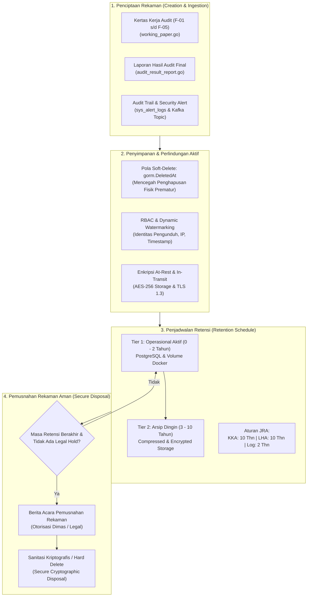

# A.5.33 Perlindungan Rekaman

> *Ringkasan internal untuk checklist kesiapan bukti. Bukan pengganti Statement of Applicability (SoA) resmi.*

---

| Parameter | Nilai |
| :--- | :--- |
| **Tema** | Organizational |
| **Judul kontrol** | Perlindungan rekaman |
| **Fokus pemeriksaan** | Rekaman dilindungi sesuai kebutuhan retensi dan integritas |
| **Contoh bukti objektif** | Retention schedule, access log, backup, disposal record |
| **Sistem** | AuditSphere (auditsphere.app), VPS 202.10.34.160 / 202.10.34.166 dan Cloud SaaS |
| **PIC** | Lead Information Security / DevSecOps (Reza) |
| **Reviewer** | [isi saat validasi] (Dimas / Group Vision) |
| **Tanggal validasi** | [isi saat validasi] |

---

## Ringkasan Nilai untuk Checklist

| Kolom checklist | Nilai | Catatan singkat |
| :--- | :--- | :--- |
| **Relevansi SoA** | **Berlaku** | Seluruh rekaman audit (KKA, LHA, Register Risiko, audit trail) wajib dilindungi dari kehilangan, pemalsuan, modifikasi tidak sah, dan pemusnahan dini sesuai standar IIA IPPF, regulasi OJK/Perbankan, dan UU PDP. |
| **Status implementasi** | **Dalam proses** | Pola *soft-delete* (`gorm.DeletedAt`) aktif di seluruh entitas database, retensi Kafka 168 jam, log audit `sys_alert_logs` tercatat, dan strategi backup harian dirancang di ISO-AS-001 Bab 6.7; namun jadwal retensi formal dan modul sanitasi aman belum lengkap. |
| **Ketersediaan bukti** | **Ada sebagian** | Model database ber-DeletedAt, skrip cadangan `sync-clone-db.sh`, repositori `sys_alert_log_repository` (`DeleteOldLogs`), dan Bab 6.7 ISO-AS-001 tersedia; Jadwal Retensi Arsip (JRA) formal, berita acara pemusnahan, dan WORM hash belum lengkap. |
| **Evidence ID / URL** | **Belum terdaftar** | Usulan EV-A5.33-01 s/d EV-A5.33-06 (lihat bagian 6). ID perlu didaftarkan di Master Audit Evidence Index. |
| **Efektivitas operasional** | **Sebagian efektif** | Pola *soft-delete* berhasil mencegah penghapusan data audit secara tidak sengaja oleh user; namun proses pemusnahan permanen berkas kedaluwarsa dan validasi berkala integritas arsip belum terstandardisasi. |
| **Desain kontrol** | **Perlu perbaikan** | Metode pembersihan log lama `DeleteOldLogs()` mengeksekusi penghapusan langsung tanpa pencadangan arsip terenkripsi terlebih dahulu, dan berkas LHA Word/PDF belum dilengkapi segel hash integritas (*tamper-evident WORM*). |
| **Status kesiapan** | **Belum siap** | Pedoman kebijakan retensi rekaman formal, matriks jadwal retensi per kategori data, dan template berita acara pemusnahan rekaman belum memenuhi kriteria kelulusan audit sertifikasi ISO 27001. |
| **Prioritas** | **Tinggi** | Rekaman audit adalah produk kerja utama dan bukti kepatuhan korporasi; kehilangan atau manipulasi rekaman dapat memicu sanksi regulasi sektor keuangan dan menggugurkan opini audit independen. |
| **Review berikutnya** | **[isi]** | Usulan: 12 bulan setelah pengesahan Kebijakan Retensi Rekaman dan implementasi modul pengarsipan dokumen jangka panjang. |

---

## 1. Justifikasi Relevansi (Berlaku)

Kontrol A.5.33 **berlaku** untuk sistem AuditSphere karena:

1. **Kewajiban Hukum dan Standar Audit Profesional (IIA IPPF Standar 2330)**: Praktik audit internal mewajibkan dokumentasi Kertas Kerja Audit (KKA) dan Laporan Hasil Audit (LHA) disimpan secara aman dan terjaga integritasnya selama jangka waktu yang ditentukan oleh regulasi perbankan/OJK (minimal 5 hingga 10 tahun).
2. **Mandat Standar ISO/IEC 27001:2022 Klausul A.5.33**: Standar mewajibkan seluruh rekaman organisasi dilindungi terhadap kehilangan, kehancuran, pemalsuan, akses tidak sah, dan rilis tidak sah sesuai dengan persyaratan undang-undang, peraturan, kontrak, dan bisnis.
3. **Perlindungan Terhadap Ancaman Pemalsuan dan Modifikasi Tidak Sah (Anti-Tampering)**: Rekaman temuan kecurangan (*fraud*), penyesuaian skor risiko, dan bukti audit digital dapat menjadi objek sengketa hukum di pengadilan. Seluruh rekaman wajib memiliki jejak integritas kriptografis yang tidak dapat diubah (*tamper-evident*).
4. **Kepatuhan Terhadap Regulasi Pelindungan Data Pribadi (UU PDP No. 27/2022)**: Rekaman audit yang memuat data pribadi auditee (PII) wajib disimpan hanya selama masa retensi yang sah dan wajib dimusnahkan secara aman (*secure cryptographic wiping*) saat masa retensi berakhir atau dasar pemrosesan tidak lagi berlaku.
5. **Pencegahan Penghapusan Prematur dan Kehilangan Data Kritis**: AuditSphere mengelola ratusan kertas kerja digital per penugasan audit; kegagalan dalam mengendalikan siklus hidup dan prosedur penghapusan dapat memicu hilangnya bukti audit penting saat pemeriksaan oleh regulator eksternal.

---

## 2. Implementasi yang Sudah Ada

Berdasarkan penelusuran repositori `risk-based-audit`, arsitektur basis data, dan dokumen keselarasan keamanan, implementasi perlindungan rekaman mencakup:

### 2.1 Penerapan Pola Soft-Delete (`gorm.DeletedAt`) di Seluruh Entitas Inti
- **Pencegahan Penghapusan Fisik Langsung**: Seluruh model data entitas bisnis pada `backend/audit-service` (`audit-plan.go`, `audit-finding.go`, `audit_result_report.go`, `working_paper.go`), `backend/risk-service` (`risk_register.go`, `action_plan.go`, `risk_approval_log.go`), dan `master-service` menyematkan `gorm.DeletedAt`. Saat pengguna menghapus data di antarmuka web, sistem tidak menjalankan kueri `DELETE` fisik melainkan memperbarui stempel waktu `deleted_at`, menjamin rekaman tetap utuh dalam basis data untuk kepentingan rekam jejak kepatuhan dan audit lanjutan.
- **Isolasi Kueri Standar**: Framework GORM secara otomatis menyaring rekaman yang berstatus *soft-deleted* pada kueri operasional normal tanpa merusak integritas relasional data masa lalu.

### 2.2 Pencatatan Audit Trail Permanen (`sys_alert_logs` & Kafka Topic `audit-logs`)
- **Model Log Keamanan Sistem Terpusat**: Entitas `backend/auth-service/models/sys_alert_log.go` mencatat kejadian keamanan krusial (login, kegagalan autentikasi, lockout, reset sandi, perubahan izin, alokasi peran). Tabel `sys_alert_logs` beroperasi dengan sifat *append-only* di mana pengguna reguler tidak memiliki hak untuk memperbarui atau menghapus baris rekaman log.
- **Streaming Pesan Audit Terisolasi**: Layanan backend mempublikasikan event ke Apache Kafka topik `audit-logs` dengan parameter `KAFKA_LOG_RETENTION_HOURS: 168` (7 hari retensi buffer), memberikan jaminan bahwa seluruh aktivitas administratif terekam secara independen dari aplikasi utama.

### 2.3 Pembatasan Akses Rekaman & Dynamic Watermarking LHA
- **Otorisasi Akses Laporan Berbasis RBAC**: Modul `backend/audit-service/pkg/docxbuilder/docx_generator.go` dan endpoint unduh LHA dilindungi secara ketat oleh Kong API Gateway dan matriks izin peran (hanya `AUDITOR`, `CAE`, dan `ADMIN` yang berwenang mengekspor rekaman laporan final).
- **Dynamic Watermarking (ISO-AS-001 Bab 6.6)**: Dokumen laporan audit yang diekspor dilengkapi penanda dinamis transparan berisi identitas pengunduh, alamat IP, dan timestamp unduh guna mencegah penyebaran rekaman tanpa otorisasi.

### 2.4 Arsitektur Pencadangan Basis Data & Kloning
- **Replikasi Basis Data Terjadwal**: Skrip `backend/scripts/sync-clone-db.sh` dan `docker-compose.clone-db.yml` menyediakan fasilitas kloning data operasional harian ke kontainer sekunder `rb_audit_postgres_clone`.
- **Kebijakan Snapshot Harian (ISO-AS-001 Bab 6.7 & 12.2)**: Sistem dirancang menjalankan snapshot basis data otomatis setiap pukul 02:00 WIB dan *continuous archiving transaction logs* dengan target RPO < 15 menit.

### 2.5 Kebijakan Retensi Multi-Tier pada Layanan Monitoring & Log
- **Retensi Metrik Prometheus**: File `monitoring/docker-compose.monitoring.yml` menetapkan retensi basis data deret waktu TSDB selama 7 hari (`--storage.tsdb.retention.time=7d`) dengan batasan ukuran 500 MB.
- **Fungsi Pemangkasan Terkendali**: File `backend/auth-service/repositories/sys_alert_log_repository.go` menyediakan metode `DeleteOldLogs(days int)` untuk membersihkan log lama berdasarkan parameter ambang hari yang ditetapkan oleh administrator sistem.

---

## 3. Identifikasi Kesenjangan (Gap Analysis)

Perbandingan antara implementasi di repositori dengan klausul ISO/IEC 27001:2022 Kontrol A.5.33 dan standar industri audit menunjukkan 8 kesenjangan utama:

| No | Parameter Perlindungan Rekaman | Target Standar ISO 27001 & IIA IPPF | Kondisi Aktual di Repositori | Status Kesenjangan |
| :-: | :--- | :--- | :--- | :-: |
| 1 | **Kebijakan Retensi & Perlindungan Rekaman** | Tersedia SOP tertulis (SOP-REC-001) yang mengatur masa simpan, perlindungan integritas, dan pemusnahan rekaman. | Baru ada acuan ringkas 5-10 tahun di Bab 6.7 ISO-AS-001; belum ada dokumen SOP formal bertanda tangan. | **Gap Tata Kelola / Kebijakan** |
| 2 | **Matriks Jadwal Retensi Arsip (JRA)** | Tabel jadwal retensi formal yang memetakan jenis rekaman (KKA, LHA, Log, Kredensial) ke masa simpan dan dasar hukumnya. | Belum ada dokumen matriks retensi terperinci yang membedakan masa simpan data operasional, log audit, dan dokumen final. | **Gap Dokumentasi** |
| 3 | **Pembersihan Log Tanpa Pengarsipan Terenkripsi** | Log lama yang dipangkas wajib diarsipkan ke secondary storage terenkripsi sebelum dihapus dari basis data primer. | Metode `DeleteOldLogs()` mengeksekusi DELETE fisik langsung tanpa tahapan kompresi, enkripsi, dan pemindahan arsip. | **Gap Teknis Pembersihan** |
| 4 | **Verifikasi Integritas Rekaman (WORM / Hash)** | Dokumen LHA dan KKA final dilengkapi segel hash digital (SHA-256) untuk menjamin anti-pemalsuan (*tamper-evident*). | Dokumen DOCX/PDF dihasilkan tanpa checksum hash permanen yang tersimpan di basis data untuk validasi keaslian. | **Gap Integritas Rekaman** |
| 5 | **Modul Pengarsipan Dingin (Cold Storage)** | Tersedia otomatisasi pemindahan KKA yang sudah selesai (> 1 tahun) ke media penyimpanan dingin terpisah yang hemat biaya dan aman. | Seluruh data audit aktif dan arsip lama masih bercampur dalam tabel PostgreSQL yang sama tanpa partisi cold storage. | **Gap Arsitektur Penyimpanan** |
| 6 | **Prosedur & Berita Acara Pemusnahan Aman** | Pemusnahan rekaman kedaluwarsa wajib melalui berita acara resmi bertanda tangan dan sanitasi data kriptografis. | Belum ada template berita acara pemusnahan rekaman dan prosedur *secure wiping* bersertifikasi. | **Gap Prosedur Pemusnahan** |
| 7 | **Pemisahan Hak Akses Arsip Cadangan (SoD)** | Hak akses ke berkas arsip dan cadangan dipisahkan ketat dari administrator operasional harian. | Akses kontainer kloning dan cadangan masih dapat diakses langsung menggunakan akun administratif default. | **Gap Pengendalian Akses** |
| 8 | **Pengujian Integritas Rekaman Berkala** | Uji pemulihan dan verifikasi keterbacaan rekaman arsip cadangan dilakukan minimal setiap semester. | Belum ada jadwal rutin dan rekam jejak laporan hasil pengujian integritas rekaman arsip digital. | **Gap Pengujian Kesiapan** |

---

## 4. Bukti Objektif yang Sudah Tersedia

1. **Penerapan Soft-Delete pada Model Data GORM**: Kolom `gorm.DeletedAt` pada seluruh entitas microservices `backend/audit-service`, `risk-service`, dan `master-service`.
2. **Struktur Log Audit Sistem Append-Only**: File `backend/auth-service/models/sys_alert_log.go` dan `repositories/sys_alert_log_repository.go` yang merekam kejadian keamanan.
3. **Streaming Pesan Audit Trail Kafka**: File `backend/auth-service/services/auth/auth_service.go` yang mengalirkan event autentikasi ke topik `audit-logs` dengan retensi 168 jam.
4. **Engine Ekspor LHA Berproteksi RBAC**: Modul `backend/audit-service/pkg/docxbuilder/docx_generator.go` yang menghasilkan dokumen formal dengan nomor LHA dan batasan peran.
5. **Skrip Kloning & Replikasi Basis Data**: File `backend/scripts/sync-clone-db.sh` dan `docker-compose.clone-db.yml` untuk duplikasi data operasional.
6. **Kebijakan Backup & Retensi Terjadwal**: Dokumen `docs/DOKUMEN_KESELARASAN_ISO27001.md` Bab 6.7 yang mendokumentasikan retensi 5-10 tahun dan enkripsi AES-256.

---

## 5. Bukti Objektif yang Masih Kurang

1. **SOP Kebijakan Retensi & Perlindungan Rekaman (SOP-REC-001)**: Kebijakan tertulis yang disahkan manajemen mengenai siklus hidup, pengarsipan, dan pemusnahan rekaman.
2. **Matriks Jadwal Retensi Arsip (Record Retention Schedule Matrix)**: Dokumen klasifikasi jadwal retensi yang mencakup seluruh tipe data (KKA, LHA, Log, Kredensial, Transaksi).
3. **Mekanisme Checksum Integritas LHA (Digital Fingerprint)**: Hash SHA-256 yang tersimpan pada tabel `audit_result_reports` saat laporan disetujui (WORM protection).
4. **Skrip Pengarsipan Log Terenkripsi Sebelum Purging**: Alur kerja otomatisasi pemindahan log lama ke arsip kompresi terenkripsi (GPG/AES-256) sebelum pembersihan database.
5. **Formulir & Berita Acara Pemusnahan Rekaman (Disposal Record)**: Template dokumen formal dan berita acara pelaksanaan penghapusan data secara aman.
6. **Laporan Pengujian Integritas & Keterbacaan Rekaman Arsip**: Berita acara uji pemulihan arsip digital berkala yang membuktikan data lama tetap dapat dibuka dan dibaca.

---

## 6. Usulan Bukti Objektif (Evidence ID)

Daftar usulan bukti objektif yang wajib diregistrasikan ke dalam Master Audit Evidence Index sistem AuditSphere:

| Evidence ID | Nama Bukti Objektif | Format / Media | Lokasi / Sumber | PIC Penyedia |
| :--- | :--- | :--- | :--- | :--- |
| **EV-A5.33-01** | SOP Kebijakan Retensi & Perlindungan Rekaman (SOP-REC-001) | Dokumen PDF / Word | `docs/policies/SOP-REC-001-Record-Retention-Policy.pdf` | Lead InfoSec / Reza |
| **EV-A5.33-02** | Matriks Jadwal Retensi Arsip (Retention Schedule Matrix) | Dokumen PDF / Spreadsheet | `docs/compliance/Record-Retention-Schedule-Matrix.pdf` | Lead InfoSec / Dimas |
| **EV-A5.33-03** | Penerapan Soft-Delete & Segel Hash Dokumen LHA | Kode Sumber & DB Migration | `backend/audit-service/models` & migration scripts | Lead Backend Dev |
| **EV-A5.33-04** | Prosedur Pengarsipan Log & Bukti Backup Terenkripsi | Skrip Cron & Konfigurasi | `backend/scripts/archive-logs.sh` & backup configs | Lead DevOps |
| **EV-A5.33-05** | Template Formulir & Berita Acara Pemusnahan Rekaman | Dokumen PDF Bertanda Tangan | `docs/compliance/Record-Disposal-Form-Template.pdf` | Legal & Compliance |
| **EV-A5.33-06** | Laporan Hasil Pengujian Keterbacaan Arsip Rekaman Berkala | Laporan Uji QA / Audit | `docs/security/reports/Archive-Readability-Test-2026.pdf` | QA & Database Admin |

---

## 7. Rencana Aksi Perbaikan (Action Plan)

Rencana aksi terstruktur guna menutup seluruh kesenjangan kontrol A.5.33 dalam kurun waktu 3 minggu ke depan:

| No | Tindakan Remediasi / Peningkatan | Target Luaran Teknis | PIC | Target Waktu |
| :-: | :--- | :--- | :--- | :-: |
| 1 | **Penyusunan & Pengesahan SOP Retensi Rekaman (SOP-REC-001)** | Dokumen formal kebijakan retensi, hak akses, dan tata cara pemusnahan aman | Reza / Dimas | 2 minggu |
| 2 | **Pembuatan Matriks Jadwal Retensi Arsip (JRA)** | Tabel pemetaan masa simpan: KKA 10 thn, LHA 10 thn, Log 2 thn, Data Sampel 1 thn | Lead InfoSec | 1 minggu |
| 3 | **Implementasi Segel Hash Kriptografis pada LHA Final** | Penyimpanan hash SHA-256 pada tabel `audit_result_reports` saat rilis untuk anti-pemalsuan | Backend Dev | 2 minggu |
| 4 | **Penyempurnaan Alur Pembersihan Log (Archive Before Purge)** | Skrip otomatisasi yang mengekspor, mengompresi, dan mengenkripsi log sebelum `DeleteOldLogs()` | DevOps Engineer | 2 minggu |
| 5 | **Penyusunan Prosedur & Berita Acara Pemusnahan Aman** | Template dokumen BA Pemusnahan Rekaman dan metode secure wiping sesuai standar | Legal / Compliance | 1 minggu |
| 6 | **Penerapan Arsitektur Partisi Penyimpanan Dingin (Cold Storage)** | Pemisahan data kertas kerja audit berusia > 2 tahun ke bucket penyimpanan dingin | Backend / DevOps | 3 minggu |
| 7 | **Pemisahan Hak Akses Cadangan Rekaman (Segregation of Duties)** | Konfigurasi izin restricted di mana developer operasional tidak memiliki akses hapus backup | DevSecOps | 1 minggu |
| 8 | **Pelaksanaan Pengujian Keterbacaan & Integritas Arsip Cadangan** | Uji sampling pembukaan kembali dokumen KKA dan log audit dari cadangan 6 bulan lalu | QA / DB Admin | 2 minggu |

---

*Dokumen ini disusun untuk melengkapi kepatuhan sistem AuditSphere terhadap standar ISO/IEC 27001:2022 Klausul Annex A.5.33.*

