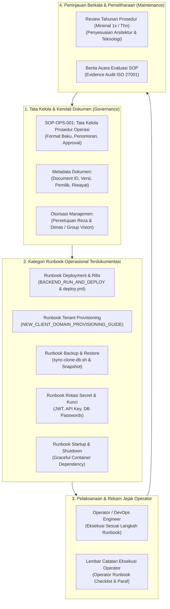

# A.5.37 Prosedur Operasi Terdokumentasi

> *Ringkasan internal untuk checklist kesiapan bukti. Bukan pengganti Statement of Applicability (SoA) resmi.*

---

| Parameter | Nilai |
| :--- | :--- |
| **Tema** | Organizational |
| **Judul kontrol** | Prosedur operasi terdokumentasi |
| **Fokus pemeriksaan** | Aktivitas operasional penting memiliki prosedur terkendali |
| **Contoh bukti objektif** | SOP, runbook, approval, version history, operator record |
| **Sistem** | AuditSphere (auditsphere.app), VPS 202.10.34.160 / 202.10.34.166 dan Cloud SaaS |
| **PIC** | Lead Information Security / DevSecOps (Reza) |
| **Reviewer** | [isi saat validasi] (Dimas / Group Vision) |
| **Tanggal validasi** | [isi saat validasi] |

---

## Ringkasan Nilai untuk Checklist

| Kolom checklist | Nilai | Catatan singkat |
| :--- | :--- | :--- |
| **Relevansi SoA** | **Berlaku** | Fasilitas pemrosesan informasi AuditSphere (VPS hosting, kontainer Docker, database PostgreSQL, gateway Kong, CI/CD pipeline, proses deployment dan pencadangan) memerlukan prosedur operasi terdokumentasi resmi guna menjamin aktivitas operasional berjalan benar, konsisten, aman, dan dapat direproduksi. |
| **Status implementasi** | **Dalam proses** | Panduan teknis pengoperasian backend, onboarding tenant, skrip deployment CI/CD, dan secure coding guide tersedia di `docs/`; namun belum distandarisasi ke dalam format dokumen SOP resmi terkendali (nomor dokumen, riwayat versi formal, approval Dimas). |
| **Ketersediaan bukti** | **Ada sebagian** | Berkas panduan Markdown (`BACKEND_RUN_AND_DEPLOY`, `NEW_CLIENT_DOMAIN_PROVISIONING`, `deploy.yml`, `SCG-001`) tersedia; dokumen formal SOP Tata Kelola Prosedur Operasi (SOP-OPS-001), lembar kendali operator, dan berita acara review berkala belum lengkap. |
| **Evidence ID / URL** | **Belum terdaftar** | Usulan EV-A5.37-01 s/d EV-A5.37-06 (lihat bagian 6). ID perlu didaftarkan di Master Audit Evidence Index. |
| **Efektivitas operasional** | **Sebagian efektif** | Otomasi deployment via GitHub Actions dan onboarding tenant berjalan efektif dan konsisten; namun prosedur operasional manual (rotasi secret, failover database, purging log) belum memiliki checklist operator terstandarisasi. |
| **Desain kontrol** | **Perlu perbaikan** | Format dokumentasi saat ini masih berupa petunjuk teknis Markdown tanpa metadata kendali dokumen baku, belum ada pemisahan repositori SOP terkendali, dan masih ada kredensial contoh yang belum disanitasi penuh. |
| **Status kesiapan** | **Belum siap** | Prosedur operasional yang ada masih berstatus developer guide informal, belum memenuhi kriteria prosedur operasi terkendali bertanda tangan yang dipersyaratkan untuk audit sertifikasi ISO 27001. |
| **Prioritas** | **Tinggi** | Ketiadaan prosedur operasi terkendali berisiko menimbulkan kesalahan manusia (*human error*), kesalahan konfigurasi keamanan (*misconfiguration*), dan kegagalan operasional saat eskalasi insiden pada infrastruktur produksi. |
| **Review berikutnya** | **[isi]** | Usulan: 12 bulan setelah pengesahan SOP Tata Kelola Prosedur Operasi TIK dan kodifikasi seluruh runbook operasional ke dalam portal dokumentasi resmi. |

---

## 1. Justifikasi Relevansi (Berlaku)

Kontrol A.5.37 **berlaku** untuk sistem AuditSphere karena:

1. **Standarisasi Pengoperasian Fasilitas Pemrosesan Informasi**: Arsitektur AuditSphere melibatkan komponen yang kompleks (VPS hosting 202.10.34.160 / 202.10.34.166, Kong API Gateway, PostgreSQL multi-database, Redis, Apache Kafka, Prometheus, Grafana, Loki). Prosedur operasi yang terdokumentasi menjamin fasilitas pemrosesan ini dioperasikan secara benar, konsisten, dan aman tanpa ketergantungan pada memori individual personel.
2. **Mandat Standar ISO/IEC 27001:2022 Klausul A.5.37**: Standar mewajibkan bahwa prosedur operasi untuk fasilitas pemrosesan informasi harus didokumentasikan dan disediakan bagi personel yang membutuhkannya, serta dipelihara sebagai dokumen terkendali (*controlled documents*).
3. **Pencegahan Kesalahan Manusia (Human Error) & Kesalahan Konfigurasi (Misconfiguration)**: Sebagian besar insiden keamanan siber dan waktu henti sistem (*downtime*) disebabkan oleh kesalahan eksekusi perintah di server produksi. Adanya runbook dan checklist operator langkah-demi-langkah (*step-by-step*) memitigasi risiko kelalaian teknis.
4. **Jaminan Kelangsungan Operasional Saat Pergantian Personel (Knowledge Transfer)**: Dokumentasi prosedur operasional yang terstruktur menjamin kesinambungan operasional tim DevSecOps dan Engineering saat terjadi pergantian atau penambahan anggota tim baru tanpa menimbulkan degradasi keamanan.
5. **Kepatuhan Terhadap Regulasi Audit & Ekspektasi Klien Enterprise**: Klien perbankan dan BUMN mewajibkan vendor solusi teknologi menyajikan Standard Operating Procedures (SOP) resmi bertanda tangan mencakup tata kelola deployment, manajemen rilis, backup, dan penanganan gangguan sistem sebagai bukti tata kelola TI yang matang.

---

## 2. Implementasi yang Sudah Ada

Berdasarkan penelusuran repositori `risk-based-audit`, artefak dokumentasi operasional dan skrip otomatisasi yang telah tersedia mencakup:

### 2.1 Dokumentasi Deployment & Pengoperasian Backend (`BACKEND_RUN_AND_DEPLOY.md`)
- **Petunjuk Menjalankan Layanan Lokal & Docker**: Berkas `docs/BACKEND_RUN_AND_DEPLOY.md` mendokumentasikan prasyarat lingkungan (Go 1.21+, Docker, PostgreSQL 16, Redis 7, Kafka), langkah eksekusi Docker Compose terpusat, kueri pengecekan status kontainer (`docker-compose ps`), dan pembacaan log kontainer (`docker-compose logs -f`).
- **Petunjuk Migrasi Skema Basis Data**: Dokumentasi memuat instruksi eksekusi migrasi skema per microservice (`go run ./cmd migrate up`) dan langkah inisialisasi awal.

### 2.2 Runbook Onboarding Tenant & Domain Klien (`NEW_CLIENT_DOMAIN_PROVISIONING_GUIDE.md`)
- **Panduan 8 Fase Onboarding Multi-Tenant**: Berkas `docs/NEW_CLIENT_DOMAIN_PROVISIONING_GUIDE.md` menyediakan panduan komprehensif mulai dari perencanaan arsitektur isolasi silo, konfigurasi DNS dan sertifikat SSL/TLS, provisioning basis data mandiri per tenant, konfigurasi routing Kong Gateway, hingga deployment frontend Nuxt 4.
- **Checklist Smoke Testing & Kepatuhan UU PDP**: Panduan menyertakan daftar periksa verifikasi fungsional pasca-onboarding dan klausul pemeliharaan privasi data auditee.

### 2.3 Prosedur Otomasi CI/CD & Deployment Produksi (`.github/workflows/deploy.yml`)
- **Runbook Berbasis Kode (Infrastructure as Code / Pipeline)**: Berkas `.github/workflows/deploy.yml` berfungsi sebagai prosedur operasional rilis otomatis yang mencakup tahapan pre-kompilasi binary Go, pengemasan arsip artefak, transfer terenkripsi via SCP, hingga eksekusi rolling deployment dan verifikasi healthcheck HTTP secara otomatis di server VPS produksi.
- **Mekanisme Rollback & Lock File**: Pipeline dilengkapi penanganan kegagalan otomatis dan proteksi konkurensi (`LOCK_FILE: /tmp/auditsphere_deploy.lock`) untuk mencegah tabrakan proses deploy ganda.

### 2.4 Panduan Pengujian & Verifikasi API (`API_Testing_Guide.md`)
- **Prosedur Pengujian End-to-End API**: Berkas `docs/API_Testing_Guide.md` dan `API_Testing_Guide.html` menyajikan petunjuk sistematis pengujian API mencakup autentikasi JWT, manajemen pengguna, modul audit, dan risk scoring, lengkap dengan koleksi Postman `Postman_Collection_RBIA_Master_Service.json`.

### 2.5 Pedoman Pengkodean Aman & Arsitektur (`SCG-001` & Architecture Guides)
- **Standar Keamanan Teknis Terdokumentasi**: Dokumen `docs/security/SCG-001-Secure-Coding-Guide.docx` dan `docs/architecture_on_premises_vs_cloud.md` mendefinisikan aturan baku penanganan rahasia, hardening kontainer Docker, least privilege DB role, dan arsitektur deployment on-premises vs cloud.

---

## 3. Identifikasi Kesenjangan (Gap Analysis)

Evaluasi kesesuaian antara dokumentasi teknis saat ini dengan klausul ISO/IEC 27001:2022 Kontrol A.5.37 menunjukkan 8 kesenjangan utama:

| No | Parameter Prosedur Operasi | Target Standar ISO 27001:2022 | Kondisi Aktual di Repositori | Status Kesenjangan |
| :-: | :--- | :--- | :--- | :-: |
| 1 | **Status Formal Dokumen Prosedur** | Prosedur operasi disahkan sebagai dokumen terkendali (*controlled SOP*) dengan nomor resmi, paraf, dan tanda tangan manajemen. | Dokumentasi saat ini berstatus panduan developer informal (format Markdown di direktori `docs/`); belum ada SOP formal tertandatangani. | **Gap Tata Kelola / Status** |
| 2 | **Metadata Kendali Dokumen Baku** | Setiap SOP memuat metadata baku: Document ID, Versi, Tanggal Efektif, Klasifikasi, Pemilik Dokumen, dan Riwayat Perubahan. | Sebagian besar berkas panduan `.md` belum memuat blok metadata kendali dokumen dan tanggal peninjauan berkala. | **Gap Metadata Dokumen** |
| 3 | **Catatan Pelaksanaan Operator (Operator Records)** | Tersedia lembar periksa (*checklist*) dan log eksekusi operator yang mendokumentasikan siapa mengeksekusi apa dan kapan. | Aktivitas pemeliharaan manual (seperti seeding, kloning database, restart kontainer) belum disertai catatan log operator formal. | **Gap Akuntabilitas Operator** |
| 4 | **Runbook Prosedur Backup & Restore Mandiri** | Tersedia SOP mandiri khusus mengenai tata cara eksekusi cadangan, enkripsi backup, dan uji restore database berkala. | Instruksi pencadangan masih tersebar pada skrip `sync-clone-db.sh` dan ringkasan Bab 12 ISO-AS-001 tanpa runbook SOP mandiri. | **Gap Prosedur Backup** |
| 5 | **Runbook Rotasi Secret & Kunci Kredensial** | Tersedia prosedur terdokumentasi mengenai jadwal dan langkah rotasi JWT Secret, API Key, dan kredensial basis data. | Belum ada runbook tertulis yang mengatur langkah-langkah rotasi secret tanpa menimbulkan downtime layanan produksi. | **Gap Prosedur Keamanan** |
| 6 | **Akses Terkendali ke Dokumen Prosedur** | Dokumen prosedur operasi disimpan pada portal terpusat dengan hak akses terkendali agar tidak membocorkan arsitektur ke publik. | Berkas dokumentasi tersimpan dalam repositori git yang sama dengan kode sumber tanpa pembatasan akses berbasis peran. | **Gap Pengendalian Akses** |
| 7 | **Prosedur Restart & Shutdown Darurat** | Tersedia panduan urutan penghentian (*graceful shutdown*) dan penyalaan ulang sistem (*startup order*) saat terjadi insiden. | Belum ada panduan baku urutan dependensi shutdown/startup kontainer (Zookeeper -> Kafka -> DB -> Services -> Kong). | **Gap Prosedur Darurat** |
| 8 | **Jadwal & Bukti Review Tahunan SOP** | Prosedur operasi ditinjau dan diperbarui minimal 1 kali per tahun atau setiap ada perubahan arsitektur signifikan. | Belum ada agenda jadwal peninjauan rutin dan berita acara review tahunan untuk seluruh prosedur operasional. | **Gap Siklus Pemeliharaan** |

---

## 4. Bukti Objektif yang Sudah Tersedia

1. **Panduan Pengoperasian Backend**: File `docs/BACKEND_RUN_AND_DEPLOY.md` yang merinci instruksi eksekusi Docker Compose, migrasi database, dan pemantauan log.
2. **Runbook Onboarding Tenant**: File `docs/NEW_CLIENT_DOMAIN_PROVISIONING_GUIDE.md` yang mendokumentasikan 8 fase penyediaan domain, database, dan aplikasi klien baru.
3. **Prosedur Pipeline CI/CD**: File `.github/workflows/deploy.yml` dan `deploy-dev.yml` yang mengotomasi kompilasi, transfer SCP, dan verifikasi healthcheck rilis.
4. **Panduan Pengujian Sistem**: File `docs/API_Testing_Guide.md` dan `API_Testing_Guide.html` beserta koleksi pengujian Postman untuk verifikasi endpoint.
5. **Standar Pengkodean Aman (SCG-001)**: Dokumen `docs/security/SCG-001-Secure-Coding-Guide.docx` yang memuat aturan operasional penanganan dependensi dan Dockerfile.
6. **Skrip Operasional Otomasi**: File `backend/scripts/sync-clone-db.sh` dan `start-all.bat` untuk otomasi duplikasi data dan inisialisasi lingkungan lokal.

---

## 5. Bukti Objektif yang Masih Kurang

1. **SOP Tata Kelola Prosedur Operasi TIK (SOP-OPS-001)**: Dokumen kebijakan payung yang mengatur standarisasi format, penomoran, pengesahan, dan distribusi seluruh SOP.
2. **Paket Runbook Operasional Terkendali Bertanda Tangan**: Kumpulan dokumen SOP resmi (SOP Deployment, SOP Backup & Restore, SOP Onboarding Tenant, SOP Monitoring) dalam format PDF bertanda tangan manajemen.
3. **Formulir Catatan Eksekusi Operator (Operator Runbook Checklist)**: Lembar periksa bertanda tangan yang merekam eksekusi aktivitas pemeliharaan berkala di lingkungan produksi.
4. **SOP Rotasi Kredensial & Kunci Enkripsi (SOP-SEC-007)**: Panduan langkah-demi-langkah rotasi berkala JWT Secret, password basis data, dan API Key.
5. **Panduan Urutan Shutdown & Startup Sistem (Graceful Startup/Shutdown Guide)**: Petunjuk urutan penanganan kontainer saat proses pemeliharaan darurat atau pemadaman terjadwal.
6. **Berita Acara Peninjauan Tahunan Prosedur Operasi**: Bukti pelaksanaan review berkala tahunan terhadap seluruh dokumen operasional TIK.

---

## 6. Usulan Bukti Objektif (Evidence ID)

Daftar usulan bukti objektif yang wajib diregistrasikan ke dalam Master Audit Evidence Index sistem AuditSphere:

| Evidence ID | Nama Bukti Objektif | Format / Media | Lokasi / Sumber | PIC Penyedia |
| :--- | :--- | :--- | :--- | :--- |
| **EV-A5.37-01** | SOP Tata Kelola Prosedur Operasi TIK (SOP-OPS-001) | Dokumen PDF / Word | `docs/policies/SOP-OPS-001-Operating-Procedures.pdf` | Lead InfoSec / Reza |
| **EV-A5.37-02** | Paket Runbook Operasional TIK Terkendali Bertanda Tangan | Dokumen PDF Bundle | `docs/runbooks/Auditsphere-Operational-Runbooks-2026.pdf` | Lead DevOps / Reza |
| **EV-A5.37-03** | Lembar Catatan Eksekusi Operator (*Operator Checklists*) | Spreadsheet / Jira Task | DevOps Operations Portal / Deployment Logs | DevOps Engineer |
| **EV-A5.37-04** | Runbook Prosedur Backup, Restore & Replikasi Basis Data | Dokumen PDF Runbook | `docs/runbooks/RUNBOOK-OPS-002-Database-Backup-Restore.pdf` | Database Admin |
| **EV-A5.37-05** | Runbook Prosedur Rotasi Secret & Kunci Kriptografi | Dokumen PDF Runbook | `docs/runbooks/RUNBOOK-SEC-003-Secret-Rotation.pdf` | DevSecOps Engineer |
| **EV-A5.37-06** | Berita Acara Peninjauan Tahunan Prosedur Operasional | Dokumen PDF Bertanda Tangan | `docs/security/reports/Annual-SOP-Review-2026.pdf` | Reza / Dimas |

---

## 7. Rencana Aksi Perbaikan (Action Plan)

Rencana aksi terstruktur guna menutup seluruh kesenjangan kontrol A.5.37 dalam kurun waktu 3 minggu ke depan:

| No | Tindakan Remediasi / Peningkatan | Target Luaran Teknis | PIC | Target Waktu |
| :-: | :--- | :--- | :--- | :-: |
| 1 | **Penyusunan & Pengesahan SOP Tata Kelola Prosedur Operasi** | Dokumen formal SOP-OPS-001 yang mengatur standar format, persetujuan, dan peninjauan SOP | Reza / Dimas | 2 minggu |
| 2 | **Formalisasi Panduan Markdown Menjadi Paket SOP Terkendali** | Konversi `BACKEND_RUN_AND_DEPLOY` dan provisioning guide menjadi berkas PDF terkendali resmi | Lead DevOps | 2 minggu |
| 3 | **Penyusunan Runbook Mandiri Backup & Restore Basis Data** | SOP operasional langkah-demi-langkah pencadangan, enkripsi backup, dan validasi restore | Database Admin | 1 minggu |
| 4 | **Penyusunan Runbook Rotasi Secret & Kunci Enkripsi** | SOP langkah-demi-langkah rotasi JWT secret, API key, dan password database tanpa downtime | DevSecOps | 2 minggu |
| 5 | **Penyusunan Panduan Urutan Graceful Shutdown & Startup** | Diagram dan instruksi urutan ketergantungan kontainer saat pemeliharaan sistem | DevOps Engineer | 1 minggu |
| 6 | **Implementasi Lembar Kendali Operator Terstandarisasi** | Template checklist pengoperasian yang wajib diisi dan diparaf operator saat maintenance | DevOps Team | 1 minggu |
| 7 | **Sentralisasi Dokumen SOP pada Portal Terproteksi** | Penyimpanan dokumen SOP pada direktori/portal internal dengan hak akses restricted | Lead InfoSec | 2 minggu |
| 8 | **Pelaksanaan Peninjauan Tahunan Prosedur & Berita Acara** | Review seluruh SOP bersama pimpinan (Dimas) dan penandatanganan berita acara evaluasi | Reza / Dimas | 3 minggu |

---

*Dokumen ini disusun untuk melengkapi kepatuhan sistem AuditSphere terhadap standar ISO/IEC 27001:2022 Klausul Annex A.5.37.*

