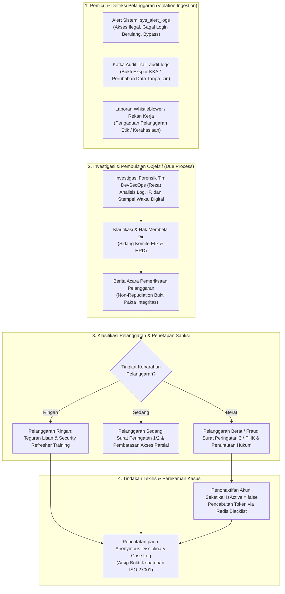

# A.6.4 Proses Disipliner

> *Ringkasan internal untuk checklist kesiapan bukti. Bukan pengganti Statement of Applicability (SoA) resmi.*

---

| Parameter | Nilai |
| :--- | :--- |
| **Tema** | People |
| **Judul kontrol** | Proses disipliner |
| **Fokus pemeriksaan** | Pelanggaran keamanan memiliki proses disipliner yang formal |
| **Contoh bukti objektif** | Disciplinary policy, case log anonim, keputusan dan approval |
| **Sistem** | AuditSphere (auditsphere.app), VPS 202.10.34.160 / 202.10.34.166 dan Cloud SaaS |
| **PIC** | Lead Information Security / DevSecOps (Reza) |
| **Reviewer** | [isi saat validasi] (Dimas / Group Vision) |
| **Tanggal validasi** | [isi saat validasi] |

---

## Ringkasan Nilai untuk Checklist

| Kolom checklist | Nilai | Catatan singkat |
| :--- | :--- | :--- |
| **Relevansi SoA** | **Berlaku** | Akses terhadap sistem AuditSphere melibatkan personel internal (Auditor, CAE, Admin, DevSecOps) dan pengguna auditee yang memproses data audit rahasia; proses disipliner formal wajib diberlakukan untuk menjamin kepatuhan, pencegahan penyalahgunaan wewenang, dan kepastian sanksi hukum. |
| **Status implementasi** | **Dalam proses** | Fondasi teknis penerimaan pakta kerahasiaan digital (`confidentiality_agreements`), penonaktifan akun instan (`IsActive = false`), lockout, pencabutan peran (`sys_alert_role_revoked`), dan blacklist token aktif; namun SOP Proses Disipliner formal dan case log anonim belum lengkap. |
| **Ketersediaan bukti** | **Ada sebagian** | Model data pakta kerahasiaan, log audit `sys_alert_logs`, endpoint manajemen peran dan deaktivasi user tersedia; dokumen kebijakan disipliner tertulis (SOP-HR-SEC-001), matriks eskalasi sanksi bertingkat, formulir berita acara, dan case log anonim belum lengkap. |
| **Evidence ID / URL** | **Belum terdaftar** | Usulan EV-A6.4-01 s/d EV-A6.4-06 (lihat bagian 6). ID perlu didaftarkan di Master Audit Evidence Index. |
| **Efektivitas operasional** | **Sebagian efektif** | Pencabutan hak akses teknis dan pemutusan sesi dapat dieksekusi seketika oleh administrator; namun alur investigasi administratif, hak pembelaan diri (*due process*), dan koordinasi formal antara Tim Keamanan dan HRD belum dibakukan. |
| **Desain kontrol** | **Perlu perbaikan** | Belum ada standarisasi kategori pelanggaran keamanan (Ringan, Sedang, Berat) yang terhubung langsung dengan sanksi ketenagakerjaan, dan belum tersedia kanal pelaporan pelanggaran anonim (*whistleblower*) yang terintegrasi. |
| **Status kesiapan** | **Belum siap** | Pedoman kebijakan proses disipliner formal yang disahkan pimpinan (Dimas), template berita acara sidang etik, dan rekam jejak penanganan kasus anonim belum memenuhi persyaratan audit sertifikasi ISO 27001. |
| **Prioritas** | **Tinggi** | Faktor manusia (*People*) merupakan salah satu kerentanan terbesar (*insider threat*); tanpa sanksi disipliner yang tegas dan adil, integritas kertas kerja audit dan perlindungan rahasia korporasi tidak dapat dijamin. |
| **Review berikutnya** | **[isi]** | Usulan: 12 bulan setelah pengesahan SOP Proses Disipliner Keamanan Informasi dan pelaksanaan sosialisasi ke seluruh staf. |

---

## 1. Justifikasi Relevansi (Berlaku)

Kontrol A.6.4 **berlaku** untuk sistem AuditSphere karena:

1. **Mitigasi Risiko Ancaman dari Dalam (Insider Threat)**: Pengguna sistem AuditSphere memiliki kewenangan luas untuk memeriksa temuan berisiko tinggi, kertas kerja investigasi kecurangan (*fraud*), dan informasi identitas pribadi (PII) auditee. Proses disipliner yang tegas menjamin akuntabilitas individu dan mencegah penyalahgunaan wewenang secara sengaja.
2. **Mandat Standar ISO/IEC 27001:2022 Klausul A.6.4**: Standar secara eksplisit mewajibkan organisasi merumuskan, memformalkan, dan mengomunikasikan proses disipliner untuk menindak personel dan pihak terkait yang melakukan pelanggaran terhadap kebijakan keamanan informasi organisasi.
3. **Penegakan Kode Etik Profesi Auditor Internal (IIA Code of Ethics)**: Auditor internal terikat pada prinsip integritas, objektivitas, kerahasiaan, dan kompetensi. Pelanggaran terhadap kerahasiaan kertas kerja audit wajib dikenakan sanksi disipliner yang sejalan dengan standar kode etik profesional.
4. **Pemberian Efek Jera (Deterrence) dan Keadilan Perlakuan**: Proses disipliner yang transparan, konsisten, dan bertingkat memberikan pemahaman yang jelas bagi seluruh karyawan mengenai konsekuensi atas kelalaian atau kesengajaan, serta menjamin praduga tak bersalah melalui proses pembuktian objektif (*due process*).
5. **Kepatuhan Terhadap Regulasi Pelindungan Data Pribadi (UU PDP No. 27/2022) & UU ITE**: Kebocoran data audit atau akses ilegal yang dilakukan oleh personel internal memiliki implikasi hukum pidana dan perdata; adanya mekanisme sanksi internal menjadi bukti itikad baik tata kelola kepatuhan korporasi di hadapan hukum.

---

## 2. Implementasi yang Sudah Ada

Berdasarkan penelusuran repositori `risk-based-audit`, arsitektur manajemen pengguna, dan modul keamanan autentikasi, implementasi pendukung proses disipliner mencakup:

### 2.1 Fondasi Hukum Digital & Pakta Kerahasiaan (`confidentiality_agreements`)
- **Persetujuan Pakta Integritas Digital**: File `backend/auth-service/models/confidentiality_agreement.go` mendefinisikan entitas `ConfidentialityAgreement` yang mengikat pengguna pada tingkat `SYSTEM`, `ROLE`, dan `PROJECT`. Setiap persetujuan mencatat `IsAccepted`, `AcceptedAt`, `IPAddress`, `UserAgent`, dan `Version` dokumen pakta kerahasiaan.
- **Bukti Persetujuan Tanpa Penyangkalan (Non-Repudiation)**: Endpoint `/confidentiality/accept` (`registry.go:160`) memastikan setiap pengguna secara sadar menyetujui batasan kerahasiaan sebelum diberikan akses ke fitur audit, menjadi bukti hukum sah saat proses disipliner dijalankan.

### 2.2 Kemampuan Penegakan Teknis Seketika (Suspension, Lockout & Role Revocation)
- **Deaktivasi Akun Administratif**: Model `backend/auth-service/models/user.go` menyediakan atribut `IsActive` (bool) dan `LockedUntil` (*time.Time). Administrator sistem dapat menonaktifkan akun pelanggar seketika melalui endpoint `DELETE /users/:id` (*soft delete*) atau `PUT /users/:id`.
- **Pencabutan Peran Seketika (Role Revocation)**: Endpoint `DELETE /roles/:id/permissions` dan pencabutan peran dari tabel `user_roles` otomatis mematikan izin akses pengguna ke data audit rahasia.
- **Pencatatan Log Aksi Disipliner Sistem**: Kejadian pencabutan peran dan penguncian akun otomatis dicatat dalam tabel `sys_alert_logs` melalui enumerasi `sys_alert_role_revoked_log` dan `sys_alert_locked_out`.

### 2.3 Pemutusan Sesi Real-Time & Blacklist Token JWT via Redis
- **Pencabutan Sesi Seketika (Immediate Session Revocation)**: Saat akun pengguna dinonaktifkan atau terjadi pelanggaran berat, sistem memanfaatkan mekanisme Redis token blacklist (`token:<jwt>` -> `revoked`) pada `auth_service.go:348` untuk memutus sesi aktif pengguna tanpa harus menunggu masa berlaku JWT kedaluwarsa.

### 2.4 Rekam Jejak Forensik Digital (Kafka `audit-logs` & `sys_alert_logs`)
- **Perekaman Bukti Pelanggaran Tidak Dapat Diubah**: Seluruh tindakan akses data, kegagalan autentikasi berulang, dan perubahan izin peran dialirkan ke Apache Kafka topik `audit-logs` dan tabel `sys_alert_logs`, menyediakan jejak audit forensik yang valid untuk pembuktian sidang disipliner internal.

### 2.5 Hubungan dengan Standar Etika Profesi Auditor Internal
- **Kepatuhan Terhadap Kode Etik IIA & Piagam Audit**: Pengguna sistem yang berprofesi sebagai auditor internal terikat pada Piagam Audit Internal (*Audit Charter*) dan kewajiban menjaga kerahasiaan informasi klien enterprise sebagaimana tertuang pada dokumen tata kelola organisasi.

---

## 3. Identifikasi Kesenjangan (Gap Analysis)

Evaluasi kesesuaian implementasi aktual terhadap klausul ISO/IEC 27001:2022 Kontrol A.6.4 menunjukkan 8 kesenjangan yang harus ditangani:

| No | Parameter Proses Disipliner | Target Standar ISO 27001 & UU Ketenagakerjaan | Kondisi Aktual di Repositori | Status Kesenjangan |
| :-: | :--- | :--- | :--- | :-: |
| 1 | **Kebijakan & SOP Proses Disipliner Formal** | Tersedia dokumen formal SOP-HR-SEC-001 bertanda tangan yang mengatur tata cara penegakan disiplin pelanggaran keamanan. | Baru tersedia fitur teknis deaktivasi dan model pakta kerahasiaan; belum ada SOP proses disipliner formal tertulis. | **Gap Tata Kelola / Kebijakan** |
| 2 | **Matriks Kategori Pelanggaran & Sanksi** | Matriks terstruktur yang mengklasifikasikan pelanggaran Ringan, Sedang, dan Berat beserta sanksinya (Lisan, SP1, SP2, SP3, PHK). | Belum ada matriks resmi yang menghubungkan tingkat keparahan insiden keamanan dengan sanksi administratif kepegawaian. | **Gap Matriks Sanksi** |
| 3 | **Buku Register Kasus Disipliner Anonim** | Pencatatan seluruh kasus penegakan disipliner keamanan dalam register anonim guna evaluasi efektivitas kontrol. | Belum ada buku log atau register pencatatan kasus disipliner terpusat yang terpelihara. | **Gap Rekam Jejak / Evidence** |
| 4 | **Prosedur Investigasi Objektif (Due Process)** | Alur pemeriksaan terstandarisasi yang memberikan hak klarifikasi dan pembelaan diri bagi terduga sebelum vonis sanksi. | Belum ada pedoman investigasi forensik internal dan tata cara sidang etik yang terdokumentasi. | **Gap Prosedur Hukum / Adil** |
| 5 | **Kanal Pelaporan Pelanggaran (Whistleblower)** | Kanal pelaporan rahasia dan aman bagi personel untuk melaporkan indikasi pelanggaran keamanan tanpa takut intimidasi. | Sistem belum memiliki saluran whistleblower terdedikasi dengan jaminan perlindungan pelapor. | **Gap Kanal Pelaporan** |
| 6 | **SOP Koordinasi Penonaktifan Cepat HR-SecOps** | SOP koordinasi darurat antara HRD dan DevSecOps untuk pemutusan akses seketika saat terjadi pelanggaran berat/fraud. | Proses pencabutan akun saat ini masih bergantung pada komunikasi lisan tanpa formulir permintaan resmi. | **Gap Alur Operasional** |
| 7 | **Template Berita Acara & Surat Peringatan** | Formulir standar Berita Acara Klarifikasi Pelanggaran dan template Surat Peringatan (SP) resmi yang disahkan legal. | Belum tersedia template dokumen hukum ketenagakerjaan baku terkait pelanggaran keamanan informasi. | **Gap Format Dokumen** |
| 8 | **Sosialisasi Rutin Konsekuensi Disipliner** | Sosialisasi tahunan kepada seluruh staf mengenai aturan disipliner dan konsekuensi hukum pelanggaran keamanan data. | Belum ada bukti jadwal rutin dan materi edukasi mengenai proses disipliner dalam program *security awareness*. | **Gap Edukasi & Sosialisasi** |

---

## 4. Bukti Objektif yang Sudah Tersedia

1. **Model Persetujuan Pakta Kerahasiaan Digital**: File `backend/auth-service/models/confidentiality_agreement.go` yang merekam stempel waktu dan identitas penerimaan pakta kerahasiaan.
2. **Fitur Teknis Deaktivasi & Penguncian Akun**: File `backend/auth-service/models/user.go` (field `IsActive`, `LockedUntil`, `DeletedAt`) yang memungkinkan isolasi akun pelanggar seketika.
3. **Endpoint Pengelolaan Akun & Peran**: File `backend/auth-service/routes/registry.go` (`DELETE /users/:id`, `DELETE /roles/:id/permissions`) untuk pencabutan izin akses.
4. **Mekanisme Blacklist Token Sesi Real-Time**: Implementasi pencabutan sesi aktif pada Redis cache (`backend/auth-service/services/auth/auth_service.go:348`).
5. **Perekaman Log Audit Forensik**: File `backend/auth-service/models/sys_alert_log.go` yang mencatat `sys_alert_role_revoked_log`, `sys_alert_locked_out`, dan event Kafka `audit-logs`.

---

## 5. Bukti Objektif yang Masih Kurang

1. **SOP Kebijakan Proses Disipliner Keamanan Informasi (SOP-HR-SEC-001)**: Dokumen resmi bertanda tangan pimpinan (Dimas) dan HRD yang mengatur alur penegakan sanksi.
2. **Matriks Klasifikasi Pelanggaran & Sanksi Bertingkat**: Panduan penentuan sanksi berdasarkan tingkat dampak pelanggaran (Ringan, Sedang, Berat).
3. **Buku Register Kasus Disipliner Anonim (Anonymous Disciplinary Case Register)**: Dokumen rekam jejak historis penanganan insiden disipliner yang disamarkan identitasnya.
4. **Template Berita Acara Klarifikasi & Surat Peringatan (SP)**: Berkas legal terstandarisasi untuk pemanggilan, pemeriksaan, dan penetapan sanksi tertulis.
5. **Formulir Permintaan Deaktivasi Akses Darurat HR-ke-SecOps**: Berita acara resmi permintaan pencabutan hak akses personel yang sedang dalam investigasi berat.
6. **Materi & Bukti Sosialisasi Proses Disipliner**: Dokumentasi pelatihan atau pakta integritas tahunan yang membuktikan karyawan memahami konsekuensi pelanggaran.

---

## 6. Usulan Bukti Objektif (Evidence ID)

Daftar usulan bukti objektif yang wajib diregistrasikan ke dalam Master Audit Evidence Index sistem AuditSphere:

| Evidence ID | Nama Bukti Objektif | Format / Media | Lokasi / Sumber | PIC Penyedia |
| :--- | :--- | :--- | :--- | :--- |
| **EV-A6.4-01** | SOP Kebijakan Proses Disipliner Keamanan (SOP-HR-SEC-001) | Dokumen PDF / Word | `docs/policies/SOP-HR-SEC-001-Disciplinary-Process.pdf` | Lead InfoSec & HRD |
| **EV-A6.4-02** | Matriks Klasifikasi Pelanggaran Keamanan & Sanksi | Dokumen PDF Matriks | `docs/compliance/Security-Violation-Sanction-Matrix.pdf` | Lead InfoSec / Dimas |
| **EV-A6.4-03** | Buku Register Kasus Disipliner Anonim (Case Log) | Spreadsheet Terproteksi | HR & SecOps Management Portal / Disciplinary Log | HRD & SecOps |
| **EV-A6.4-04** | Paket Template Berita Acara & Surat Peringatan (SP) | Dokumen PDF / Form | `docs/compliance/Disciplinary-Action-Templates.pdf` | Legal & HRD |
| **EV-A6.4-05** | Bukti Eksekusi Pencabutan Akun & Blacklist Sesi | Tangkapan Layar & Log DB | PostgreSQL `sys_alert_logs` & Redis Revocation Logs | DevSecOps Engineer |
| **EV-A6.4-06** | Rekaman Penerimaan Pakta Kerahasiaan oleh Pengguna | Ekspor Basis Data | PostgreSQL `confidentiality_agreements` sample | Lead Backend Dev |

---

## 7. Rencana Aksi Perbaikan (Action Plan)

Rencana aksi terstruktur guna menutup seluruh kesenjangan kontrol A.6.4 dalam kurun waktu 3 minggu ke depan:

| No | Tindakan Remediasi / Peningkatan | Target Luaran Teknis | PIC | Target Waktu |
| :-: | :--- | :--- | :--- | :-: |
| 1 | **Penyusunan & Pengesahan SOP Proses Disipliner Keamanan** | Dokumen formal SOP-HR-SEC-001 yang disahkan bersama oleh Reza, HRD, dan Dimas | Reza / Dimas / HRD | 2 minggu |
| 2 | **Pembuatan Matriks Tingkat Pelanggaran & Sanksi Bertingkat** | Tabel klasifikasi baku: Pelanggaran Ringan (Teguran/Refresher), Sedang (SP1/SP2), Berat (SP3/PHK) | Lead InfoSec / HRD | 1 minggu |
| 3 | **Penyediaan Register Kasus Disipliner Anonim (Case Log)** | Register terproteksi untuk mendokumentasikan setiap kasus pelanggaran dan disposisi sanksinya | HRD & SecOps | 1 minggu |
| 4 | **Penyusunan Template Berita Acara Sidang Etik & Surat Peringatan** | Formulir legal baku pemanggilan, klarifikasi pembelaan diri, dan surat sanksi resmi | Legal / HRD | 2 minggu |
| 5 | **Standarisasi Prosedur Deaktivasi Darurat HR-ke-SecOps** | SOP dan tiket formulir cepat pencabutan akun dalam waktu < 1 jam saat terjadi insiden fraud | HRD & DevSecOps | 1 minggu |
| 6 | **Sosialisasi Konsekuensi Pelanggaran & Pakta Integritas** | Penyelenggaraan sesi briefing kesadaran keamanan mengenai konsekuensi disipliner kepada seluruh staf | Lead InfoSec | 2 minggu |
| 7 | **Penyempurnaan Integrasi Notifikasi Alert Pelanggaran Berulang** | Pemicu alert otomatis ke SecOps saat akun terindikasi melakukan percobaan akses ilegal berulang | Backend Dev | 2 minggu |
| 8 | **Evaluasi Tahunan Kebijakan Disipliner Bersama Manajemen** | Review keselarasan kebijakan disipliner terhadap peraturan perundang-undangan ketenagakerjaan dan PDP | Reza / Dimas | 3 minggu |

---

*Dokumen ini disusun untuk melengkapi kepatuhan sistem AuditSphere terhadap standar ISO/IEC 27001:2022 Klausul Annex A.6.4.*

