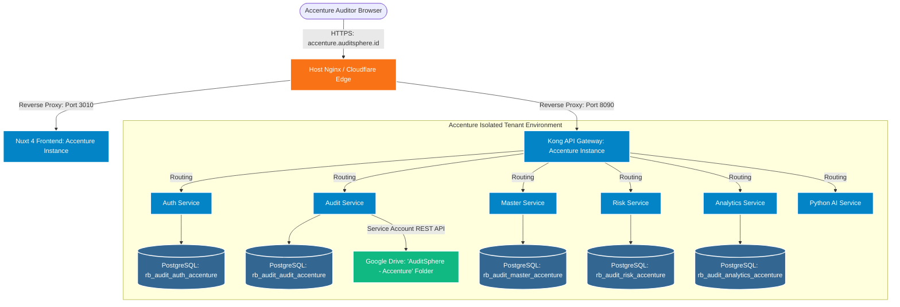

# AuditSphere Client Tenant & Domain Provisioning Guide
## How to Onboard a New Client Domain, Database Instance & Google Drive Storage

This documentation provides an end-to-end guide on provisioning a new client tenant for **AuditSphere (Risk-Based Internal Audit - RBIA)**. 

To illustrate every step concretely, this guide uses **Client A: Accenture** with the target domain **`accenture.auditsphere.id`**.

---

## Table of Contents
1. [Architecture & Multi-Tenancy Model](#1-architecture--multi-tenancy-model)
2. [Tenant Planning & Provisioning Parameters](#2-tenant-planning--provisioning-parameters)
3. [Phase 1: Domain, DNS & SSL/TLS Configuration](#phase-1-domain-dns--ssltls-configuration)
4. [Phase 2: Database Provisioning & Schema Migrations](#phase-2-database-provisioning--schema-migrations)
5. [Phase 3: Google Drive Cloud Storage Provisioning](#phase-3-google-drive-cloud-storage-provisioning)
6. [Phase 4: Backend Microservices & Kong Gateway Setup](#phase-4-backend-microservices--kong-gateway-setup)
7. [Phase 5: Frontend (Nuxt 4) Deployment & Branding](#phase-5-frontend-nuxt-4-deployment--branding)
8. [Phase 6: Automated Tenant Onboarding Script](#phase-6-automated-tenant-onboarding-script)
   - [Phase 6b: Site Generator Provisioner (host service)](#phase-6b-site-generator-provisioner-host-service)
9. [Phase 7: Verification & Smoke Testing Checklist](#phase-7-verification--smoke-testing-checklist)
10. [Phase 8: Maintenance, Backup & Data Compliance (UU PDP / GDPR)](#phase-8-maintenance-backup--data-compliance-uu-pdp--gdpr)

---

## 1. Architecture & Multi-Tenancy Model

AuditSphere manages sensitive corporate internal audit information: audit charters, risk appetite statements, fraud investigation fieldwork, working papers, and executive findings. Because of strict regulatory frameworks (**ISO 27001**, **GDPR**, and Indonesia's **Undang-Undang Perlindungan Data Pribadi / UU PDP**), client data isolation is critical.

### The Silo Isolation Architecture (Recommended)

AuditSphere uses a **Containerized Silo Multi-Tenant Architecture** (or isolated database instance per tenant), mirroring the successful dev/prod separation already established in the infrastructure:



### Key Isolation Benefits
- **Zero Cross-Tenant Leakage**: Dedicated databases ensure that no query can accidentally return another client's audit findings.
- **Dedicated Cloud Storage**: Audit fieldwork files, interview evidence, and observation attachments are segregated in an isolated Google Drive root directory.
- **Custom Retention & Encryption**: Allows custom encryption keys and backup intervals per client.

---

## 2. Tenant Planning & Provisioning Parameters

Before provisioning a new client, define their tenant parameters:

| Parameter | Example Value (Accenture) | Description |
| :--- | :--- | :--- |
| **Client Name** | `Accenture` | Official organization name displayed in UI |
| **Tenant Slug / Code** | `accenture` | Lowercase alphanumeric identifier used for URLs, DBs, and folders |
| **Frontend Domain** | `accenture.auditsphere.id` | Client URL accessible by corporate auditors |
| **API Domain** | `api-accenture.auditsphere.id` | API Gateway endpoint |
| **Server IP (VPS)** | `202.10.34.166` | Hosting IP address |
| **Assigned Frontend Port** | `3010` | Internal container port for tenant Nuxt frontend |
| **Assigned Kong Gateway Port**| `8090` (Proxy), `8019` (Admin)| Internal container ports for tenant Kong gateway |
| **Database Prefix** | `rb_audit_*_accenture` | Isolated database names |
| **Google Drive Root Folder**| `AuditSphere - Accenture` | Dedicated folder on Google Drive |
| **Client Admin Email** | `admin@accenture.com` | Initial administrator account |

---

## Phase 1: Domain, DNS & SSL/TLS Configuration

### 1. Configure DNS Records
Add DNS `A` or `CNAME` records at your DNS Registrar (e.g., Cloudflare, Route 53, or Niagahoster):

```dns
# Type    Name                  Target          TTL
A         accenture             202.10.34.166   300 (Auto)
A         api-accenture         202.10.34.166   300 (Auto)
```

> [!TIP]
> If you have a wildcard DNS record `*.auditsphere.id -> 202.10.34.166`, `accenture.auditsphere.id` and `api-accenture.auditsphere.id` will resolve automatically without manual DNS intervention!

### 2. Configure SSL/TLS Certificate (Let's Encrypt / Certbot)
On the hosting server, issue SSL certificates using Certbot:

```bash
# Obtain certificate for both frontend and backend subdomains
sudo certbot certonly --nginx \
  -d accenture.auditsphere.id \
  -d api-accenture.auditsphere.id \
  --agree-tos \
  --email admin@auditsphere.id \
  --non-interactive
```

### 3. Setup Host Reverse Proxy (Nginx)
Create `/etc/nginx/sites-available/accenture.auditsphere.id.conf`:

```nginx
# ─────────────────────────────────────────────────────────────
# AuditSphere Frontend - accenture.auditsphere.id
# ─────────────────────────────────────────────────────────────
server {
    listen 80;
    server_name accenture.auditsphere.id;
    return 301 https://$host$request_uri;
}

server {
    listen 443 ssl http2;
    server_name accenture.auditsphere.id;

    ssl_certificate /etc/letsencrypt/live/accenture.auditsphere.id/fullchain.pem;
    ssl_certificate_key /etc/letsencrypt/live/accenture.auditsphere.id/privkey.pem;
    include /etc/letsencrypt/options-ssl-nginx.conf;
    ssl_dhparam /etc/letsencrypt/ssl-dhparams.pem;

    client_max_body_size 100M;

    location / {
        proxy_pass http://127.0.0.1:3010; # Accenture Frontend Container
        proxy_http_version 1.1;
        proxy_set_header Upgrade $http_upgrade;
        proxy_set_header Connection 'upgrade';
        proxy_set_header Host $host;
        proxy_cache_bypass $http_upgrade;
        proxy_set_header X-Real-IP $remote_addr;
        proxy_set_header X-Forwarded-For $proxy_add_x_forwarded_for;
        proxy_set_header X-Forwarded-Proto $scheme;
    }
}

# ─────────────────────────────────────────────────────────────
# AuditSphere API Gateway - api-accenture.auditsphere.id
# ─────────────────────────────────────────────────────────────
server {
    listen 80;
    server_name api-accenture.auditsphere.id;
    return 301 https://$host$request_uri;
}

server {
    listen 443 ssl http2;
    server_name api-accenture.auditsphere.id;

    ssl_certificate /etc/letsencrypt/live/accenture.auditsphere.id/fullchain.pem;
    ssl_certificate_key /etc/letsencrypt/live/accenture.auditsphere.id/privkey.pem;
    include /etc/letsencrypt/options-ssl-nginx.conf;
    ssl_dhparam /etc/letsencrypt/ssl-dhparams.pem;

    client_max_body_size 100M;

    location / {
        proxy_pass http://127.0.0.1:8090; # Accenture Kong Gateway Proxy
        proxy_http_version 1.1;
        proxy_set_header Host $host;
        proxy_set_header X-Real-IP $remote_addr;
        proxy_set_header X-Forwarded-For $proxy_add_x_forwarded_for;
        proxy_set_header X-Forwarded-Proto $scheme;
    }
}
```

Enable the configuration and reload Nginx:
```bash
sudo ln -s /etc/nginx/sites-available/accenture.auditsphere.id.conf /etc/nginx/sites-enabled/
sudo nginx -t && sudo systemctl reload nginx
```

---

## Phase 2: Database Provisioning & Schema Migrations

Each microservice in AuditSphere connects to its own database. For Accenture, we create isolated databases with the prefix `rb_audit_*_accenture`.

### 1. Create Tenant Databases in PostgreSQL

`scripts/onboard-tenant.sh` does this for you (step 2), skipping any database
that already exists so re-onboarding a tenant is safe. To do it by hand:

```bash
docker exec -i rb_audit_postgres psql -U postgres <<EOSQL
CREATE DATABASE rb_audit_auth_accenture;
CREATE DATABASE rb_audit_audit_accenture;
CREATE DATABASE rb_audit_master_accenture;
CREATE DATABASE rb_audit_risk_accenture;
EOSQL
```

There is no `rb_audit_analytics_accenture`. `analytics-service` is stateless —
`cmd/main.go` starts a gin server and opens no database handle — so an analytics
database would be created and never connected to.

> [!NOTE]
> The services authenticate as the `postgres` superuser from their config, so a
> per-tenant database user is not wired up today. Adding one means overriding
> `DATABASE_USERNAME` / `DATABASE_PASSWORD` in the tenant's generated compose
> file as well as creating the role — granting privileges alone changes nothing.

### 2. Run Database Migrations & Initial Seeders

Run these **inside the tenant's containers**, not on the host:

```bash
TENANT=backend/tenants/accenture
COMPOSE="docker compose --project-directory $TENANT --env-file $TENANT/.env"

$COMPOSE run --rm --no-deps auth-service-accenture   ./auth migrate up
$COMPOSE run --rm --no-deps auth-service-accenture   ./auth seed      # roles & permissions
$COMPOSE run --rm --no-deps audit-service-accenture  ./audit migrate up
$COMPOSE run --rm --no-deps master-service-accenture ./master migrate
$COMPOSE run --rm --no-deps risk-service-accenture   ./risk up

# Demo dataset only — skip these for a clean, empty tenant
$COMPOSE run --rm --no-deps audit-service-accenture  ./audit seed
$COMPOSE run --rm --no-deps master-service-accenture ./master seed
$COMPOSE run --rm --no-deps risk-service-accenture   ./risk seed
```

> [!WARNING]
> **Do not run the migration binaries from the host.** The services resolve
> Postgres at the hostname `postgres`, a Docker network alias that does not
> resolve outside the bridge, and `backend/docker-compose.yml` publishes no
> Postgres port — so a host-run migration cannot reach the database at all.

> [!WARNING]
> **The env var is `DATABASE_NAME`, not `DB_NAME`.** The config key is
> `database.name`, which viper's env-key replacer maps to `DATABASE_NAME`.
> `DB_NAME` is bound to nothing: setting it is silently ignored and the service
> falls back to the shared database in `config.yaml` — migrating and seeding the
> wrong tenant. Running through the tenant's compose file avoids the trap
> entirely, since `DATABASE_NAME` is already set there per service.

The migrate verbs are **not** interchangeable between services — see the table
in [Phase 6](#phase-6-automated-tenant-onboarding-script). In particular
`./risk migrate up` fails, and `./analytics migrate up` boots a web server that
never exits.

> [!NOTE]
> The auth seeder creates the roles `ADMIN`, `AUDITOR`, `EXECUTIVE`, `AUDITEE`, `VIEWER` and `DEPARTMENT_HEAD` with their permissions, and the `admin` user. Run by hand like this, without `ADMIN_PASSWORD` and `SEED_DEMO_USERS`, it falls back to `admin` / `password123` **and** creates the demo sample users. Use `onboard-tenant.sh` instead, which generates the admin password (see Phase 6, "First admin"). Verified against code on 2026-11-24 (`backend/auth-service/pkg/database/seeders/seeder.go`).

---

## Phase 3: Google Drive Cloud Storage Provisioning

AuditSphere uses Google Drive via raw REST API calls (`backend/audit-service/pkg/media/gdrive.go`) using a Google Cloud Service Account. File uploads (interview recordings, working paper attachments, evidence documents) are organized in a hierarchy under a client root folder.

### 1. Prepare Google Cloud Service Account
1. Open [Google Cloud Console](https://console.cloud.google.com/).
2. Enable **Google Drive API**.
3. Under **IAM & Admin > Service Accounts**, create a service account: `auditsphere-storage@<project-id>.iam.gserviceaccount.com`.
4. Create and download a JSON key. Place it securely at:
   `backend/audit-service/pkg/config/gdrive-credentials.json`.

### 2. Create the Client Root Folder in Google Drive
1. Log in to Google Drive with your organization administrator account.
2. Create a folder named: **`AuditSphere - Accenture`**.
3. Open the folder and copy the **Folder ID** from the browser address bar:
   ```
   https://drive.google.com/drive/folders/1bX7yZ9kL0mN8pQ2rS4tU6vW8xYz1234A
                                          └──────────────────────────────┘
                                                 default_folder_id
   ```
4. Click **Share** on the folder and add your Service Account email:
   `auditsphere-storage@<project-id>.iam.gserviceaccount.com`
   with role **Editor** (so it can create subdirectories and write files).

### 3. Pre-create Tenant Folder Structure
AuditSphere automatically organizes documents into nested subfolders. You can optionally pre-create or let `gdrive.go` auto-generate them:
- `AuditSphere - Accenture/`
  - `audit_charter/`
  - `fieldwork/`
  - `observations/`
  - `interviews/`
  - `working_papers/`
  - `evidence_documents/`
  - `reports/`

### 4. Configure `audit-service` Configuration
Update or override `backend/audit-service/pkg/config/config.yaml` for Accenture:

```yaml
gdrive:
  enabled: true
  auth_mode: "service_account"
  credentials_json_path: "./pkg/config/gdrive-credentials.json"
  default_folder_id: "1bX7yZ9kL0mN8pQ2rS4tU6vW8xYz1234A" # Accenture Root Folder ID
```

> [!TIP]
> If Google Drive quota is exceeded or internet is unavailable, `backend/audit-service/pkg/media/gdrive.go` has an automatic fallback to local disk storage (`uploads/AuditSphere - Accenture/...`), guaranteeing zero downtime for auditors.

---

## Phase 4: Backend Microservices & Kong Gateway Setup

### 1. Tenant Kong Gateway Configuration

Each tenant runs **its own Kong container** with its own declarative config at
`backend/tenants/<slug>/kong/kong.yml`, rendered by the generator from
`scripts/templates/kong-tenant.yml.tpl`. Do not add client domains to the shared
`backend/kong-gateway/kong/prod/kong.yml` — that gateway belongs to the control
plane (`auditsphere.app`) and routes to the shared services.

Two things in the tenant config are worth knowing about:

**Every upstream is tenant-scoped.** Routes point at `auth-service-<slug>`,
`audit-service-<slug>` and so on, so the gateway has no route that could reach
another tenant's services even though all containers share one bridge network.

**`/api/v1/resend` and `/api/v1/provisioning` are deliberately absent.** Creating
Resend keys and provisioning tenants are control-plane privileges. Since
2026-11-24 the old `POST /api/v1/resend/provision` API no longer exists at all
(tenant keys come from `scripts/provision-tenant-email.sh`, Phase 6 step 6). The
tenant's `auth-service` also runs with an empty `RESEND_MASTER_API_KEY` and no
`PROVISIONER_URL` (its `/provisioning` routes answer 503) as a second lock.

CORS is set to the tenant's own origin only. It is not on the hot path — the
frontend calls `/api/v1` same-origin and the Nuxt server proxies to the gateway —
but it matters for clients hitting `api-<slug>.auditsphere.id` directly. Never
widen it to `"*"`: with `credentials: true` a wildcard origin is both invalid
and a cross-tenant leak.

Validate a generated config before starting the stack:
```bash
docker run --rm -e KONG_DATABASE=off \
  -v "$PWD/backend/tenants/accenture/kong:/cfg:ro" \
  kong:3.4 kong config parse /cfg/kong.yml
```

### 2. Tenant Docker Compose Configuration

Do not hand-write this file. `scripts/generate-tenant-stack.sh` renders it from
`scripts/templates/docker-compose.tenant.yml.tpl` into
`backend/tenants/<slug>/docker-compose.yml`, along with the tenant's Kong config:

```bash
./scripts/generate-tenant-stack.sh accenture "Accenture"
```

The generator does the bookkeeping that is easy to get wrong by hand:

| Concern | How the generator handles it |
| :--- | :--- |
| **Host ports** | Allocated from `backend/tenants/registry.tsv`, starting at 3010 / 8090 / 8019 and skipping any port another tenant already holds. |
| **Service naming** | Every service is suffixed with the slug (`auth-service-accenture`). All tenants share the `rb_audit_network` bridge, so two tenants both claiming the alias `auth-service` would make cross-tenant routing a DNS coin flip. |
| **Database routing** | `DATABASE_NAME` per service, set in the compose file. The config key is `database.name`, which viper's env-key replacer maps to `DATABASE_NAME` — `DB_NAME` is bound to nothing and silently falls back to the shared database. |
| **Token isolation** | A fresh `JWT_SECRET` and `APP_SIGNATURE_KEY` per tenant, written to `backend/tenants/<slug>/.env` (mode 600, gitignored). The stock `config.yaml` ships one hardcoded `jwt.secret` for every service in the repo — left in place, a token minted for one tenant validates on every other tenant. |
| **Redis isolation** | A dedicated logical DB index per tenant. Sessions, MFA challenges and rate-limit counters are unprefixed keys; on a shared index they collide. Redis defaults to 16 databases, so index 0 (control plane) plus 15 tenants is the ceiling. |
| **Storage** | The tenant's evidence silo is bind-mounted into `audit-service` at `/root/uploads`, and `GDRIVE_ENABLED=false` keeps fieldwork out of the shared Drive service account. |
| **Port exposure** | Kong and the frontend publish on `127.0.0.1` only, so the host Nginx vhost is the sole way in and the TLS certificate cannot be bypassed. |

Regenerating an existing tenant requires `--force`, and reuses its ports, Redis
index and secrets — rotating `JWT_SECRET` would sign out every active auditor.

> [!WARNING]
> Both Dockerfiles copy pre-built artefacts rather than compiling: the Go
> services need their `linux/amd64` binaries present, and the frontend needs
> `frontend/.output`. A build succeeds with a stale or missing artefact and only
> fails at container start, so the generator's preflight checks for both.

---

## Phase 5: Frontend (Nuxt 4) Deployment & Branding

### 1. Tenant Frontend Container

The tenant's Nuxt container is part of the generated stack — there is no
separate `/app/rbia-frontend-<slug>` directory to create. It runs the same
`frontend/Dockerfile` image as every other tenant; only its environment differs.

The generated service points the browser and the server at different places, on
purpose:

```yaml
# Browser-facing: same-origin, so no preflight and no third-party cookies.
API_BASE_URL: /api/v1
ANALYTICS_API_BASE_URL: /api/analytics

# Server-side: Nuxt proxies those paths to this tenant's own gateway.
API_BASE_URL_SERVER: http://kong-accenture:8080/api/v1/**
ANALYTICS_API_BASE_URL_SERVER: http://kong-accenture:8080/api/analytics/**
```

Pointing the browser at `https://api-accenture.auditsphere.id` directly also
works — the Nginx vhost and the tenant Kong CORS origin are both provisioned for
it — but the same-origin default avoids CORS on the request path entirely.

The container publishes on `127.0.0.1:<fe_port>`; the host Nginx vhost from
Phase 1 is what makes it reachable at the client's domain.


### 2. Client Branding & Customization
To customize the logo and brand for Accenture in `frontend/components/Logo.vue`:
- Place `accenture-logo.png` in `frontend/public/branding/accenture-logo.png`.
- The logo dynamically checks `useRuntimeConfig().public.tenantName` or defaults to AuditSphere.

---

## Phase 6: Automated Tenant Onboarding Script

> Verified against code on 2026-11-24 (`scripts/onboard-tenant.sh`,
> `scripts/generate-tenant-stack.sh`, `backend/provisioner-service`,
> `backend/auth-service/routes/registry.go`). Re-check after changes to them.

`scripts/onboard-tenant.sh` runs the whole pipeline. It calls the stack
generator from Phase 4 first, so the ports and secrets exist before anything
needs them. There are two ways to run it, and both run the same 9 steps:

- **From the CLI on the VPS**, as below.
- **From the Site Generator** (`/site-generator`, role `ADMIN`, control plane
  only). The UI starts a job on the host provisioner, which runs this script
  with `--progress` and streams the steps to the browser. Installing that host
  service and the script flags it uses are in Phase 6b.

```bash
chmod +x scripts/onboard-tenant.sh scripts/generate-tenant-stack.sh

# Production: options first, then --, then <slug> <client name>
./scripts/onboard-tenant.sh --domain accenture.auditsphere.app \
    --admin-name "Siti CAE" --admin-email cae@accenture.example -- accenture "Accenture"

# Local development: <slug>.localhost, plain HTTP, no email, Nginx or Certbot
./scripts/onboard-tenant.sh --local --empty-data -- accenture "Accenture"
```

The older positional form (`<slug> <client name> [fe_port] [kong_port]` with the
flags after it) still works.

| Flag | Effect |
| :--- | :--- |
| `--local` | Target `<slug>.localhost` over HTTP; skip email (step 6) and the Nginx vhost and Certbot (step 9) |
| `--empty-data` | Migrate only, no demo records (**default**) |
| `--with-demo-data` | Also run the demo seeders for audit, master and risk, and the sample login users (all `password123`) |
| `--skip-start` | Provision everything but leave the stack stopped (steps 7 and 8 are `skipped`) |
| `--ic-lha-due-days`, `--ic-mgmt-response-due-days` | Internal-control due days for the audit report (LHA, default 30) and the management response (default 14), 1-365. Written to the tenant `.env` and seeded into audit-service's settings only if the setting is missing. CLI only: the Site Generator cannot set them (see the status note in `docs/FITUR_DAN_PEMBAGIAN_TUGAS_AUDITSPHERE.md`, 1.4) |

The other flags (`--domain`, `--fe-port`/`--api-port`, `--admin-name`/`--admin-email`,
`--skip-email`, `--health-timeout`, `--allow-no-tls`, `--progress`, `--dry-run`)
are listed in Phase 6b, "Script options added for the provisioner".

**Ports.** If you give no ports, the generator takes the next free pair: not in
`backend/tenants/registry.tsv` and not listening on the host
(`generate-tenant-stack.sh` `next_free`). If you request a port (`--fe-port`,
`--api-port`, or the positional form) and another tenant holds it in the
registry or something is listening on it, step 1 **fails**. The script no longer
moves a requested port to the next free one. Re-onboarding an existing slug
keeps its registered ports. `backend/tenants/registry.tsv` is the source of truth.

### What each step does

The keys are the ones in the `@@PROGRESS` lines and in the Site Generator's job view
(`STEP_KEYS` in `onboard-tenant.sh`; `docs/provisioning-job-contract.md`).

| Step | Key | Action |
| :--- | :--- | :--- |
| 1 | `generate` | Validate input; preflight (docker, compose v2, prebuilt binaries and `frontend/.output`, `rb_audit_network`, a running Postgres, nginx/certbot in production); generate the compose stack and Kong config; allocate ports, Redis index, secrets and a per-run image tag |
| 2 | `databases` | Create `rb_audit_{auth,audit,master,risk}_<slug>`, skipping any that already exist |
| 3 | `build` | Build the 6 tenant images (5 services + frontend), tagged `<UTC timestamp>-<git sha>` |
| 4 | `migrate` | Run migrations, the auth seeder (roles, permissions, first admin) and the risk reference catalogs **inside the containers**; demo seeders only with `--with-demo-data` |
| 5 | `storage` | Create the dedicated evidence storage silo |
| 6 | `email` | Create a sending-only Resend key for the tenant (`scripts/provision-tenant-email.sh tenant ... --no-restart`). Skipped in local mode, with `--skip-email`, or when `/etc/auditsphere/email.env` is missing. Never fatal: a Resend error is reported as `skipped` ("Email provisioning FAILED") |
| 7 | `start` | Start the 7 containers (5 services, Kong, frontend) |
| 8 | `health` | Wait (default 120 s, `--health-timeout`) until Kong is healthy, auth-service answers `/health`, a request through the tenant's Kong reaches auth-service, and the frontend answers on its port |
| 9 | `ingress` | Production only: write the Nginx vhosts (previous config restored if `nginx -t` rejects it), reload nginx, then issue TLS with certbot. Fails if DNS does not resolve or certbot fails, unless `--allow-no-tls` |

There is no `rb_audit_analytics_<slug>` database. `analytics-service` is
stateless — `cmd/main.go` starts a gin server and opens no database handle; it
forwards scoring requests to the shared `python-ai` model server.

### Why migrations run inside the containers

The services resolve Postgres at the hostname `postgres`, which is a Docker
network alias. It does not resolve on the host, and `backend/docker-compose.yml`
publishes no Postgres port — so running the migration binaries from the host
cannot reach the database at all. Step 4 uses `docker compose run --rm --no-deps`
instead, which also means `DATABASE_NAME` comes from the generated compose file
and a tenant migration can no longer be aimed at the shared database.

The migrate verbs differ per service and are **not** interchangeable:

| Service | Migrate | Seed |
| :--- | :--- | :--- |
| `auth` | `./auth migrate up` | `./auth seed` |
| `audit` | `./audit migrate up` | `./audit seed` |
| `master` | `./master migrate` | `./master seed` |
| `risk` | `./risk up` | `./risk seed` |

`./risk migrate up` fails with `unknown command "migrate"`, and
`./analytics migrate up` ignores its arguments and boots the HTTP server — under
`set -e` that hangs the script indefinitely rather than erroring.

The auth seeder is not optional even for an empty-data tenant: it creates the
roles and permissions required to log in, and the first admin. Step 4 also runs
`./risk seed --catalog-only` (standard risk factors and audit universe); on a
risk image without that flag the step finishes with "WARNING: risk catalogs missing".

**First admin.** For a new tenant the script generates a random 20-character
password and passes it to `./auth seed` as `ADMIN_PASSWORD`, through the
environment only. The username is always `admin`; `--admin-name` and
`--admin-email` set the name and email. The password appears **only** in the
final `@@RESULT` line, and the Site Generator shows it once, to the admin who
started the job. When the tenant already has an `admin` (re-onboarding), its
password is left unchanged and `@@RESULT` reports `null`. If the tenant's
auth-service image does not support `ADMIN_PASSWORD` (`./auth seed --help`),
step 4 fails rather than create the shared default password.

> [!WARNING]
> **Hand over the generated password securely and have the client change it at
> first login.** MFA is not enforced for the first admin. With `--with-demo-data`
> the sample users (`auditor`, `dept_head`, `new_dept_head`, `auditee`, `viewer`)
> are also created, all with `password123`: never use demo data on a client
> instance that will hold real data.

> [!IMPORTANT]
> Back up `backend/tenants/<slug>/.env` alongside the tenant's database. It
> holds the JWT signing secret and is not in git; losing it signs out every
> auditor on that instance.

**Email.** Tenant email is step 6 of this script. There is no email API any more:
`POST /api/v1/resend/provision` has been removed from auth-service (only the
Resend webhook `POST /api/v1/resend/webhook` remains, `routes/registry.go`), and
the Site Generator does not call it. The shared sending domain is set up once
with `scripts/provision-tenant-email.sh setup-domain` / `verify-domain`. A tenant
whose step 6 was skipped or failed can get its key later with
`./scripts/provision-tenant-email.sh tenant <slug> "<Client Name>"`, the command
the step prints.


---

## Phase 6b: Site Generator Provisioner (host service)

The Site Generator runs `scripts/onboard-tenant.sh` as a real background job
on the VPS and streams its progress to the browser. The chain is:
browser → Kong → control-plane auth-service (`/api/v1/provisioning/*`, JWT +
platform-admin check) → **provisioner** on the host (`X-Provisioner-Token`) →
`onboard-tenant.sh --progress`. The interface is defined in
`docs/provisioning-job-contract.md`. Phase 6 describes the script and its 9
steps; this section covers installing the host side once.

> Verified against code on 2026-11-24 (`backend/provisioner-service`,
> `backend/auth-service/controllers/provisioning`, `deploy/`, Kong prod config,
> `frontend/pages/site-generator`). Steps 2-9 have so far only been exercised as
> a dry run; the open checks on a real Docker host are listed in
> `docs/FITUR_DAN_PEMBAGIAN_TUGAS_AUDITSPHERE.md`, 1.4.

What the provisioner passes to the script (`ScriptArgs` in
`internal/provisioner/validate.go`): `--progress`, `--dry-run`, `--local` or
`--domain`, the two ports (only when both were given), `--admin-name`,
`--admin-email`, `--with-demo-data`/`--empty-data` and `--skip-email`. It does
**not** pass `--allow-no-tls`, `--health-timeout`, `--skip-start` or the
`--ic-*` due-days flags. So a production job started from the UI fails at step 9
when DNS or certbot is not ready; finish such a tenant from the CLI. A
production job without a domain uses `<slug>.auditsphere.app` (or the
provisioner's `BASE_DOMAIN` environment, if set).

### Prerequisites on the VPS

- The control-plane stack is running (`rb_audit_network`, `rb_audit_postgres`).
- The checkout the provisioner uses (`PROVISIONER_REPO_DIR`, default
  `/app/rbia-repo`) holds the prebuilt artifacts that the tenant images copy:
  `backend/{auth,audit,master,risk,analytics}-service/<binary>` (linux/amd64)
  and `frontend/.output`. Step 1 fails if any of them is missing. Tenant
  images are built from whatever is in that checkout, so refresh those
  artifacts before onboarding.
- `curl`, `nginx`, `certbot` (or `--allow-no-tls`, see below), and
  `/etc/auditsphere/email.env` for email (optional; step 6 is skipped without it).
- `backend/tenants/registry.tsv` in that checkout is the port registry. Never
  `git reset --hard` or `git checkout` that file on the VPS, or the tenants
  onboarded since the last commit lose their port reservations.

### Install

```bash
# 1. Build the binary (workstation or CI; static, linux/amd64)
cd backend/provisioner-service
CGO_ENABLED=0 GOOS=linux GOARCH=amd64 go build -trimpath -o provisioner ./cmd/provisioner

# 2. On the VPS, as root
install -d -m 0755 /opt/auditsphere /etc/auditsphere
install -m 0755 provisioner /opt/auditsphere/provisioner
install -m 0600 deploy/provisioner/provisioner.env.example /etc/auditsphere/provisioner.env
openssl rand -hex 32            # paste as PROVISIONER_TOKEN in /etc/auditsphere/provisioner.env
ip -4 addr show docker0         # PROVISIONER_ADDR must be this address (the env example sets 172.17.0.1:8790;
                                # the binary's own default is 127.0.0.1:8790, which containers cannot reach)
install -m 0644 deploy/provisioner/auditsphere-provisioner.service /etc/systemd/system/
systemctl daemon-reload
systemctl enable --now auditsphere-provisioner
journalctl -u auditsphere-provisioner -n 20 --no-pager

# 3. Liveness, from the host and from the auth-service container
curl -s http://172.17.0.1:8790/healthz                                   # {"status":"ok"}
docker exec rb_audit_auth_service wget -qO- http://host.docker.internal:8790/healthz
```

The service runs as root, because onboarding writes `/etc/nginx`, reloads
nginx and runs certbot and docker. It binds to the docker0 address only, and
the binary refuses wildcard and public addresses. Do not open 8790 in the
firewall. If the container cannot reach it (step 3, second command) under
firewalld, check that the docker bridges are in the `docker` zone
(`firewall-cmd --get-active-zones`).

### Wire auth-service, Kong and nginx

1. **auth-service**: set `PROVISIONER_URL=http://host.docker.internal:8790`
   and `PROVISIONER_TOKEN=<same token>` in the control-plane env file
   (`backend/.env`, see `backend/.env.example`). `backend/docker-compose.prod.yml`
   passes both through and maps `host.docker.internal` to the docker0 gateway.
   Recreate auth-service through the normal deploy. With the URL empty, the
   provisioning routes answer 503. Tenant stacks never get these variables.
2. **Kong**: `backend/kong-gateway/kong/prod/kong.yml` has the service
   `auth-service-provisioning` (route `/api/v1/provisioning`,
   `read_timeout` 1 h, `response_buffering: false`). Apply it with
   `scripts/sync-kong.sh`. The tenant Kong template has no such route.
3. **nginx (SSE)**: copy `deploy/nginx/auditsphere-provisioning-sse.conf` to
   `/etc/nginx/snippets/` and `include` it in the `server { }` block of the
   control-plane vhost(s). It sends only
   `/api/v1/provisioning/jobs/<id>/events` straight to Kong (127.0.0.1:8080)
   with buffering off and a 1 h read timeout. Then run `nginx -t && systemctl reload nginx`.
   Without it the UI still works, because it falls back to polling `GET /jobs/{id}`.

### Script options added for the provisioner

| Flag | Effect |
| :--- | :--- |
| `--progress` | Print `@@PROGRESS {json}` lines for the 9 steps (`running`/`done`/`skipped`/`failed`) |
| `--dry-run` | Validate, then emit the whole sequence and a fake `@@RESULT`. No side effects. Every message starts `[dry run]` |
| `--dry-run-fail <step>` | Dry run only: simulate a failure at that step |
| `--domain <slug>.<base>` | Tenant domain. The API is `api-<slug>.<base>` |
| `--fe-port`, `--api-port` | Pin ports. Rejected if another tenant holds them or they are in use on the host |
| `--admin-name`, `--admin-email` | First admin (username `admin`). The password is generated and printed **only** in `@@RESULT` |
| `--skip-email` / `--no-email` | Skip step 6 |
| `--health-timeout <s>` | Step 8 wait (default 120 s) for Kong, auth-service `/health`, Kong→auth routing and the frontend |
| `--allow-no-tls` | Production: when DNS or certbot is unavailable, report step 9 `skipped` and finish on HTTP instead of failing |

```bash
# Try the UI flow without touching anything
./scripts/onboard-tenant.sh --dry-run --progress --local -- demo "Demo Client"
# Next free ports (what GET /ports/next returns)
./scripts/generate-tenant-stack.sh --next-ports      # {"fe_port":3011,"api_port":8091}
```

A job that fails after step 1 leaves a partly provisioned tenant, and its slug
is in the registry. Fix the cause, then re-run the same command from the CLI:
onboarding is idempotent (existing databases, secrets and ports are kept; an
existing admin keeps its password, and `@@RESULT` then reports the password as
`null`).

### Per-tenant image tags (and migrating existing tenants)

Tenant images are now named `rb_audit_tenant_<slug>_<service>:<tag>`, with
the tag in the tenant's `.env` as `TENANT_IMAGE_TAG`. Every onboarding run
writes a new tag (`<UTC timestamp>-<git sha>`). Onboarding one tenant
therefore no longer overwrites the shared `rb_audit_*:latest` images that
other tenants use. To roll a tenant back, put the previous tag back in its
`.env` and run `docker compose ... up -d`. Remove old tags with
`docker image ls 'rb_audit_tenant_<slug>_*'` and `docker image rm`.

Stacks generated before this change keep `image: rb_audit_*:latest` and run
unchanged until they are regenerated. When it suits you, migrate each one:

```bash
TENANT_STORAGE_ROOT=/var/data/auditsphere/storage \
  ./scripts/generate-tenant-stack.sh <slug> "<Client Name>" --force   # add --local for local tenants
docker compose --project-directory backend/tenants/<slug> \
  --env-file backend/tenants/<slug>/.env up -d --build
```

This keeps ports, secrets and data and runs no seeders. Note that it builds
from the current checkout. No compose file in the repo other than old tenant
stacks names `rb_audit_*:latest`. Once every tenant is migrated, those images
are unused and can be removed.


---

## Phase 7: Verification & Smoke Testing Checklist

After provisioning, complete this verification checklist before handing off credentials to the client:

| Step | Verification Test | Expected Result | Pass/Fail |
| :--- | :--- | :--- | :---: |
| **1. DNS Resolution** | `nslookup accenture.auditsphere.id` | Resolves to VPS IP (`202.10.34.166`) | [ ] |
| **2. HTTPS Security** | `curl -Iv https://accenture.auditsphere.id` | HTTP 200/301, Valid SSL Certificate | [ ] |
| **3. API Health Check** | `curl https://api-accenture.auditsphere.id/api/v1/auth/health` | `{"status":"ok"}` | [ ] |
| **4. Database Isolation** | Run test query on `rb_audit_audit_accenture` | Table `audit_engagements` exists and is empty | [ ] |
| **5. Google Drive Upload** | Upload sample interview audio/PDF in Audit Fieldwork | File appears in Google Drive folder `AuditSphere - Accenture` | [ ] |
| **6. Local Disk Fallback**| Disable internet/revoke Drive token temporarily | File saves to `/uploads/AuditSphere - Accenture/` without error | [ ] |
| **7. User Authentication**| Log in as Tenant Admin at `https://accenture.auditsphere.id` | JWT issued with tenant claim, dashboard loads < 2s | [ ] |

---

## Phase 8: Maintenance, Backup & Data Compliance (UU PDP / GDPR)

### 1. Isolated Daily Tenant Database Backups
To comply with audit retention and SLA policies, back up the client's databases daily:

```bash
#!/bin/bash
# Backup script: /opt/scripts/backup-tenant.sh
TENANT="accenture"
TIMESTAMP=$(date +"%Y%m%d_%H%M%S")
BACKUP_DIR="/backups/tenants/${TENANT}/${TIMESTAMP}"
mkdir -p "$BACKUP_DIR"

for DB in auth audit master risk analytics; do
  docker exec rb_audit_postgres pg_dump -U postgres rb_audit_${DB}_${TENANT} | gzip > "${BACKUP_DIR}/${DB}.sql.gz"
done

# Encrypt backup using GPG
gpg --batch --yes --passphrase-file /etc/backup-key.txt -c "${BACKUP_DIR}"/*.sql.gz
```

Add to crontab:
```cron
0 2 * * * /opt/scripts/backup-tenant.sh accenture
```

### 2. Client Offboarding & Right to be Forgotten (UU PDP Compliance)
If the client contract terminates, UU PDP mandates secure data erasure:
1. **Archive & Export**: Export all database dumps and Google Drive files into an encrypted bundle and deliver to the client.
2. **Purge Databases**:
   ```sql
   DROP DATABASE rb_audit_auth_accenture;
   DROP DATABASE rb_audit_audit_accenture;
   DROP DATABASE rb_audit_master_accenture;
   DROP DATABASE rb_audit_risk_accenture;
   DROP DATABASE rb_audit_analytics_accenture;
   ```
3. **Purge Google Drive Storage**: Move the `AuditSphere - Accenture` root folder to Google Drive Trash and empty Trash permanently.
4. **Deactivate Domain & Nginx Block**: Remove `/etc/nginx/sites-enabled/accenture.auditsphere.id.conf` and revoke Certbot certificate.

---

## Summary Reference Table

```
Client Name          : Accenture
Frontend URL         : https://accenture.auditsphere.id
API Gateway URL      : https://api-accenture.auditsphere.id
Database Cluster     : PostgreSQL 16 (Databases: rb_audit_*_accenture)
Cloud Storage        : Google Drive Root (Folder: 'AuditSphere - Accenture')
Storage Fallback     : Local FS (/uploads/AuditSphere - Accenture/...)
Target SLA           : Search < 5s, Dashboard < 2s (Multi-AZ & Redis-backed)
Compliance           : ISO 27001, GDPR, Indonesian UU PDP
```
